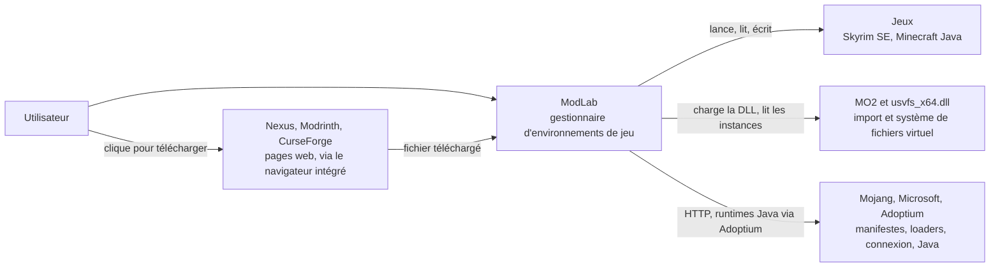
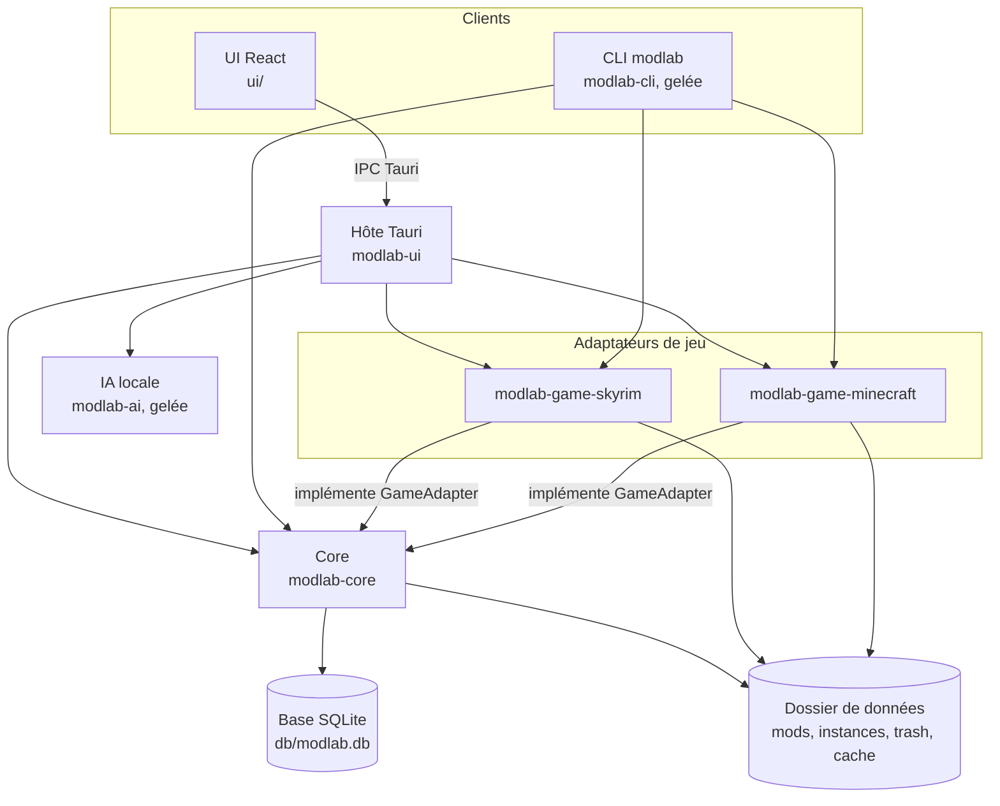
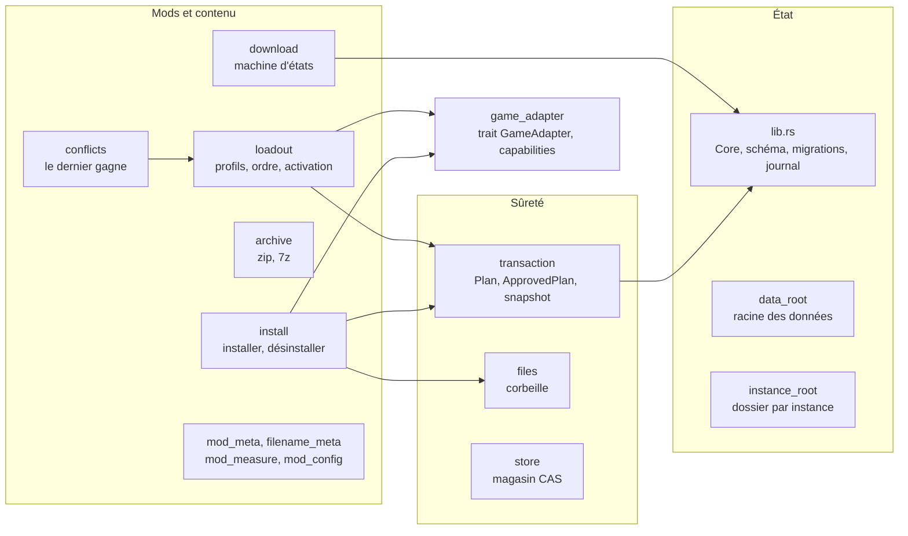

# Architecture

Le code fait foi (voir DECISIONS, 2026-11-28 Docs du projet). Ce fichier décrit ce qui existe aujourd'hui. Il remplace l'ancien `01-architecture-decidee.md` (archive). Les écarts avec la cible sont listés au §7, sans solution : la revue d'architecture n'a rien tranché. `fichier:ligne` renvoie à l'arbre de travail du 2026-11-28.

## 1. Zoom 1 : le système

- Aucune API Nexus, CurseForge ou Modrinth n'est appelée : l'humain clique dans le navigateur intégré, ModLab suit le téléchargement (DECISIONS, 2026-11-26 Download / pipeline).
- MO2 n'est jamais modifié : ModLab lit son instance et charge sa DLL (ADR 0003).

## 2. Zoom 2 : les blocs

Les flèches sont les dépendances de crates (`Cargo.toml:2-9`, `Cargo.toml` de chaque crate). Deux faits qui ne se lisent pas dans le schéma idéal :

- L'hôte Tauri appelle les adaptateurs directement, sans passer par le Core, pour le lancement et le déploiement (écart E2).
- `modlab-ai` ne dépend de rien : l'hôte lui passe des faits (`crates/modlab-ai/src/lib.rs:1-14`).

| Bloc | Rôle réel |
| --- | --- |
| UI React (`ui/`) | Interface. Montre ce que les capabilities déclarent. Miroir TS du contrat écrit à la main (`ui/src/api.ts:1-6`) |
| Hôte Tauri (`crates/modlab-ui`) | Pont IPC, mais aussi navigateur intégré (second WebView2), téléchargements, lancement des jeux, session MSA. Tient l'état de session (`crates/modlab-ui/src/lib.rs:24`) |
| Core (`crates/modlab-core`) | Base SQLite et journal, loadouts, installation, conflits, transactions, archives, magasin CAS, contrat `GameAdapter` |
| Adaptateurs | Tout ce qui est propre à un jeu. Un crate par jeu |
| IA locale | Moteur de règles + reformulation par un modèle local optionnel. Présente, gelée |
| CLI | 12 sous-commandes de test et d'import (`crates/modlab-cli/src/main.rs:40-130`). Présente, gelée |
| Base SQLite | Vérité de l'état (loadouts, mods, téléchargements, journal) |
| Dossier de données | Fichiers des mods, instances, corbeille, caches, secrets (§5) |

## 3. Zoom 3 : les modules

### 3.1 Core (`crates/modlab-core/src/lib.rs:15-29`)

Le module `store` n'est appelé que par la CLI (écart E9). Flèches : dépendances principales.

### 3.2 Adaptateurs de jeu

| Crate | Modules | Ce qu'il porte |
| --- | --- | --- |
| `modlab-game-skyrim` | `lib` (adaptateur), `installer`, `fomod`, `mo2`, `usvfs`, `engine`, `skse`, `plugins`, `graphics`, `vanilla`, `dependencies`, `categories`, `archive_meta`, `tool_archive` | Installation et FOMOD, import MO2, déploiement USVFS, lancement SKSE, `plugins.txt` (lecture des en-têtes par `esplugin`) |
| `modlab-game-minecraft` | `lib` (adaptateur), `install`, `instance`, `launch`, `loader_install`, `branch_loader`, `msa`, `official_launcher`, `dependencies`, `categories`, `filename`, `archive_meta`, `tool_archive` | Jars en dépôt direct, instances `.<slug>`, installation des loaders, Java, lancement par JVM directe, connexion MSA |

Le trait `GameAdapter` (`crates/modlab-core/src/game_adapter.rs:825`) couvre : identité et capabilities, détection, emplacements de chemins, métadonnées d'archive, catégories, dépendances, et l'installation en étapes (`stage_archive`, `prepare_install`, `prepare_guided`, `retract_files`, lignes 937-974). Le lancement et le déploiement n'en font pas partie (`game_adapter.rs:821-824`).

**Hôte Tauri** (`crates/modlab-ui/src/`) : `lib.rs` (état, enregistrement des commandes), `commands/` (une commande IPC par fichier de domaine : `mods`, `loadouts`, `launch`, `downloads`, `browser`, `paths`, `settings`, `assistant`, `shell`, `msa`, `mc_loader`), `browser`, `downloads`, `download_progress`, `source_page`, `paths`, `ipc_paths`, `msa_store`.

## 4. Principes cibles

Méthode : monolithe modulaire, découpé par domaines, en ports et adaptateurs, sans dogme (DECISIONS, 2026-11-28 Revue d'architecture). Ce sont des cibles, pas l'état du code.

1. Un seul moteur. Le Core est la source de vérité. L'UI, la CLI et un futur MCP en sont des clients.
2. Le Core ne dépend ni d'une interface ni d'un jeu. Un jeu est un adaptateur qui implémente un port du Core.
3. Une plateforme de mods serait un second port (Provider). Il n'existe pas aujourd'hui.
4. Toute modification d'état passe par une transaction : plan, approbation, instantané, application, vérification, retour arrière.
5. L'interface montre ce que les capabilities déclarent, sans test d'identifiant de jeu (ADR 0005).
6. Rien n'est supprimé en direct (corbeille interne) et le déploiement ne touche pas le dossier réel du jeu quand c'est possible (ADR 0001).
7. L'IA n'a jamais d'accès direct aux fichiers ni au shell : IA → MCP → niveaux de permission de ModLab (lecture, modification réversible, action dangereuse) → Core. Les modifications passent par des outils transactionnels (planifier, appliquer, historique).

## 5. Données

### 5.1 Base

SQLite via `rusqlite` avec SQLite embarqué (`crates/modlab-core/Cargo.toml:9`). Tables créées dans `crates/modlab-core/src/lib.rs:284-335` : `event` (journal), `instance`, `instance_path_override`, `loadout`, `mod_`, `loadout_entry`, `game_path_override`, `download`. Les migrations ajoutent des colonnes une à une (`add_column_if_missing`, `lib.rs:341-343`). Pas de table de révisions : une révision est un événement `loadout.snapshot` du journal (`transaction.rs:118-122`).

### 5.2 Résolution de la racine des données

`resolve_data_root` (`crates/modlab-core/src/data_root.rs:1-8,16-37`) choisit, dans cet ordre :

1. la variable d'environnement `MODLAB_DATA_ROOT`, si elle existe ;
2. `F:\ModLab`, si sa base y est ;
3. `.modlab-dev` (dossier relatif, ignoré par git), si sa base y est ;
4. `F:\ModLab`, si ce dossier existe ;
5. `.modlab-dev`.

L'UI et la CLI utilisent cette même fonction. La base est `db/modlab.db` ; un ancien `modlab.db` à plat est encore ouvert (`data_root.rs:49-67`).

### 5.3 Disposition des dossiers sous la racine

| Chemin | Contenu | Preuve |
| --- | --- | --- |
| `db/modlab.db` | Base | `crates/modlab-core/src/data_root.rs:57-65` |
| `mods/<id>` | Mods Skyrim gérés | `crates/modlab-game-skyrim/src/lib.rs:107` |
| `instances/<jeu>/.<slug>` | Dossier d'une instance Minecraft (mods, config, packs, saves) | `crates/modlab-core/src/instance_root.rs:105` |
| `staging/<id>` | Archive dépaquetée avant installation | `crates/modlab-core/src/game_adapter.rs:964` |
| `trash/` | Corbeille interne | `crates/modlab-core/src/files.rs:19-21` |
| `downloads/<jeu>` | Fichiers capturés par le navigateur | `crates/modlab-ui/src/downloads.rs:54,146` |
| `cache/` | Caches (assets Minecraft, runtimes Java, installeurs) | `crates/modlab-game-minecraft/src/launch.rs:926` |
| `secrets/` | Jetons MSA chiffrés (DPAPI), jamais dans SQLite | `crates/modlab-ui/src/msa_store.rs:17` |
| `models/*.gguf` | Modèle local optionnel | `crates/modlab-ui/src/commands/assistant.rs:92` |
| `store/blobs` | Magasin CAS, écrit seulement par la CLI | `crates/modlab-cli/src/main.rs:182` |

Ni `games/skyrimse`, ni `loadout.toml`, ni dépôt git interne n'existent (aucune occurrence dans `crates/`).

## 6. Contraintes techniques connues

- Un seul `Vfs` USVFS par processus. Le process Tauri tient le sien (`crates/modlab-ui/src/commands/launch.rs:809`) : pas de déploiement parallèle de deux loadouts. Si le besoin vient, il faudra un processus déployeur par session (ADR 0001).
- USVFS est chargé par `libloading` avec un binding écrit à la main, confiné au crate Skyrim (`usvfs.rs:17-27,44`). La DLL est celle de MO2, trouvée par le slot de chemin `usvfs_dll`. Les noms de symboles de l'en-tête public ne sont pas ceux de la DLL réelle (build 0.5.5.1) : toujours vérifier un symbole avant de l'appeler. La version de la DLL n'est pas lue. La DLL n'est pas fournie par ModLab (dette avant toute distribution). La fin de session se détecte en sondant `GetVFSProcessList`, pas par le processus lancé (`skse64_loader.exe` passe la main au jeu puis se termine) : tout outil lancé sous le VFS doit réutiliser ce mécanisme. L'instance USVFS porte un nom différent de celle de MO2 (ADR 0001, 0003).
- Conflits de fichiers : le dernier de la séquence reçue gagne. Le Core ne décide pas de l'ordre (`conflicts.rs:6,44`, ADR 0002). Il ignore les fichiers de rangement (`meta.ini`, `thumbs.db`, `desktop.ini`), sinon tout serait en conflit (`conflicts.rs:187`, liste non exhaustive). Pour MO2, la 1re ligne de `modlist.txt` est la priorité maximale ; l'import inverse la séquence (`mo2.rs:29,79,90`). Les instances importées avant le 24 nov. gardent l'ordre inversé.
- L'import MO2 est en lecture seule, par chemin source, hors CAS (ADR 0003). Conséquences : si MO2 est déplacé, les mods pointent dans le vide ; aucun verrou entre MO2 et ModLab ; l'import est une photo, pas une synchronisation. Aucun déploiement qui écrit vraiment dans le dossier du jeu ne doit sortir avant que les mods passent par le CAS.
- Un instantané de transaction ne capte que l'état en base, pas les octets des fichiers (`transaction.rs:118-121`, ADR 0003). Il suffit tant que le déploiement n'écrit rien dans le vrai dossier du jeu.
- Archives : `zip` et `sevenz-rust` en Rust pur, sans `7z.dll` (`crates/modlab-core/Cargo.toml:15-16`). RAR n'est pas pris en charge.
- IA locale : `llama-cpp-2` derrière la feature `local-llm`, désactivée par défaut (`crates/modlab-ai/Cargo.toml:15-19`, ADR 0004). La compiler demande LLVM et CMake sur la machine de build. Le modèle ne se charge jamais pendant une partie (`crates/modlab-ui/src/lib.rs:27-29`).
- Minecraft : une application Azure personnelle échoue à l'étape Xbox ; le client public par défaut est autorisé par Mojang (DECISIONS, 2026-11-26 Jouer Minecraft).
- Navigateur intégré : un second WebView2 posé sur le premier, car Nexus envoie `X-Frame-Options` (`crates/modlab-ui/Cargo.toml:27-30`). Il demande la feature `unstable` de Tauri.
- Tauri : l'état est un `Mutex<Core>` dans un seul process (`crates/modlab-ui/src/lib.rs:25`).
- Windows seulement (WebView2, DPAPI, USVFS).

## 7. Écarts connus avec la cible

Le réel et la cible ne coïncident pas sur les points suivants. Aucune solution proposée : chaque ligne attend la revue d'architecture.

| # | Écart | Preuve |
| --- | --- | --- |
| E1 | Le Core connaît Minecraft : colonnes et champs `mc_loader`, `mc_loader_version`, `mc_game_version` ; liste figée de loaders | `crates/modlab-core/src/lib.rs:232-247,341-343` ; `crates/modlab-core/src/loadout.rs:249` |
| E2 | Le vocabulaire de sections de jeu (`Packs`, `Worlds`, `Servers`) est dans l'enum du Core | `crates/modlab-core/src/game_adapter.rs:33-35` |
| E3 | L'hôte Tauri est un second moteur : lancement, déploiement USVFS, `plugins.txt`, FOMOD, synchro du loader Minecraft y vivent | `crates/modlab-ui/src/commands/launch.rs:809,884,918` ; `crates/modlab-ui/src/commands/mods.rs:436,912,1084` ; `crates/modlab-ui/src/lib.rs:362,392` |
| E4 | Le contrat `GameAdapter` ne couvre pas le lancement, le déploiement ni le diagnostic | `crates/modlab-core/src/game_adapter.rs:821-824` |
| E5 | La liste des adaptateurs est figée à deux, dans l'hôte | `crates/modlab-ui/src/lib.rs:281` |
| E6 | Pas de Provider : le Core ne connaît aucune plateforme de mods, `source_host` est une chaîne | `crates/modlab-core/src/lib.rs:5-7` ; `crates/README.md`, section `modlab-game-minecraft` (« Pas encore ») |
| E7 | Pas de MCP : aucun crate, aucune dépendance. L'interface affiche deux lignes « Phase 3 » | `Cargo.toml:2-9` ; `ui/src/components/Features/Settings/SettingsPane.tsx:814-826` |
| E8 | SQLite sans WAL ni `busy_timeout`. L'écrivain unique repose sur un `Mutex` dans le seul process Tauri ; la CLI ouvre le même fichier | `crates/modlab-core/src/lib.rs:259-264` ; `crates/modlab-ui/src/lib.rs:25` ; `crates/modlab-cli/src/main.rs:12-19` |
| E9 | Le CAS n'est pas branché sur l'installation : seule la CLI l'utilise | `crates/modlab-cli/src/main.rs:182` ; aucun `Store` dans `crates/modlab-ui/src` ni dans les adaptateurs |
| E10 | Le cycle de transaction est partiel : approbation immédiate sans humain, instantané en base seulement, lancement SKSE et `sync_engine_mod_direct_install` hors cycle | `crates/modlab-core/src/transaction.rs:1-40,250-327` ; `.bframe/ETAT.md` (ligne Refactor) |
| E11 | L'UI compare l'identifiant de jeu en plus des capabilities (14 comparaisons) | `ui/src/api.ts:2267,2374` ; `ui/src/app/useMcLoaderBranch.ts:155,258` ; `ui/src/App.tsx:395` ; `ui/src/components/Features/Instance/BranchHeader.tsx:50` ; `ui/src/spaces/instance/useInstanceSpace.ts:504,519` |
| E12 | La CLI n'a pas d'option `--json` ni de test d'intégration | `crates/modlab-cli/src/main.rs:3,40-130` |
| E13 | LOOT est déclaré comme outil mais non intégré (pas de tri). xEdit : aucun code | `crates/modlab-game-skyrim/src/lib.rs:41-44` (`id: "loot"`) |
| E14 | IA locale : pas de grammaire contrainte, pas de choix de modèle, chargé à chaque appel, pas de déchargement ni de file d'attente | `crates/modlab-ai/src/llama.rs:6-9` ; `crates/modlab-ui/src/commands/assistant.rs:71-92` |
| E15 | Les types TS du contrat sont écrits à la main, sans génération depuis Rust | `ui/src/api.ts:1-6` ; ADR 0005 |
| E16 | Les écrans Profil, Boutique et Atelier de patchs n'ont aucun moteur derrière (DECISIONS, 2026-11-28 Communauté) | `ui/src/components/Features/Community/MarketplacePage.tsx:21` |

## 8. Risques

| Risque | Impact | État |
| --- | --- | --- |
| Pas d'équivalent Rust à Mutagen (lecture typée des records Bethesda) | Pas d'analyse de conflits au niveau des records | `esplugin` ne lit que les en-têtes. xEdit orchestré reste l'option sans nouveau risque ; un parseur Rust ou un sidecar .NET Mutagen sont des replis. Pas de code ni de décision (ROADMAP, « analyse fine des plugins »). xEdit n'est pas installé sur la machine de test (`spikes/README.md`) |
| Le déploiement USVFS dépend d'une installation MO2 et d'une DLL d'un autre âge | Lancement Skyrim bloqué sans la DLL | Non testé en jeu sur cette machine (`.bframe/TACHES.md`, lot 1) |
| Perte de fichiers par un bug du moteur | Perte de confiance | Corbeille interne, installation préparée puis renommée. Lancement SKSE hors cycle (E10) |
| Le second moteur dans l'hôte Tauri grossit | Core et hôte divergent, difficile à tester | E3 |
| Services tiers non maîtrisés (client Microsoft, pages Nexus) | Casse sans préavis | Client Prism par défaut ; second WebView2 |
| Conditions des plateformes de mods | Le navigateur Modrinth prévu peut être refusé | Modrinth interdit d'afficher modrinth.com dans une application ; son API demande un User-Agent et limite à 300 requêtes par minute. CurseForge demande une clé d'API, et certains mods refusent la distribution par un tiers. À vérifier avant le navigateur Modrinth |
