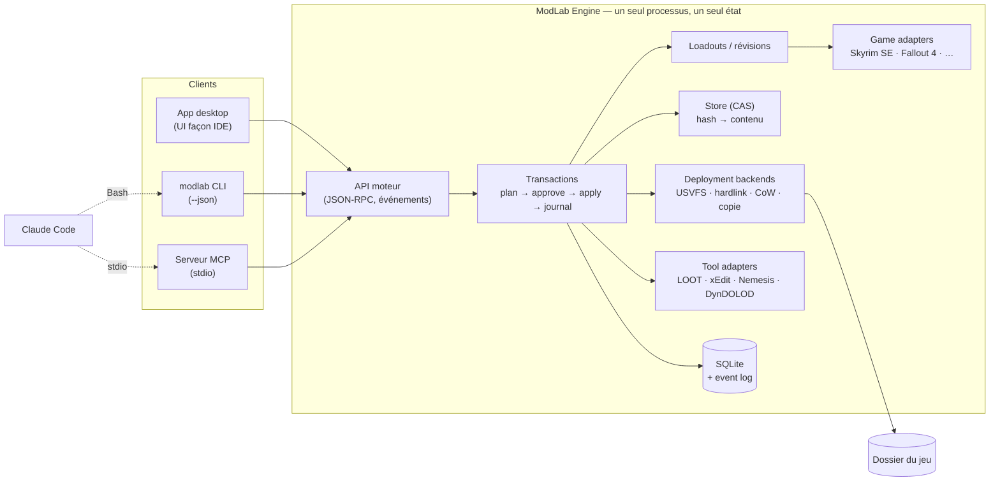

# ModLab — Analyse, cadrage & fondations techniques

> **Statut :** brouillon v0.3 pour discussion — 14 septembre 2026 (v0.2 : direction UI « IDE / GitHub / Claude Code » ; v0.3 : shell « cadre + feuille + flottants », barre du bas unique)
> **Auteur :** Claude (Opus 5), à partir de ta demande + du cahier des charges ChatGPT (`ModLab_Cahier_des_Charges.docx`)
> **But de ce doc :** qu'on soit d'accord sur *ce qu'on construit, pourquoi, avec quoi, et dans quel ordre* avant d'écrire une ligne de code.
>
> **Légende :** 💬 question pour toi · 💡 idée / suggestion · ⚠️ limite ou risque · ✅ recommandation ferme · 🧭 jalon de décision

---

## Sommaire

1. [Ce que j'ai compris de ta demande](#1-ce-que-jai-compris-de-ta-demande)
2. [Mon avis (bref) sur le cahier des charges ChatGPT](#2-mon-avis-bref-sur-le-cahier-des-charges-chatgpt)
3. [Analyse des références : ce qu'on prend à chacun](#3-analyse-des-références--ce-quon-prend-à-chacun)
4. [Architecture cible](#4-architecture-cible)
5. [Stack : choix, pourquoi, limites](#5-stack--choix-pourquoi-limites)
6. [Design system — proposition v0](#6-design-system--proposition-v0)
7. [MCP + Claude Code](#7-mcp--claude-code)
8. [Superpouvoirs privés](#8-superpouvoirs-privés)
9. [L'équipe virtuelle → agents Claude Code](#9-léquipe-virtuelle--agents-claude-code)
10. [Suivi de projet : ClickUp vs Asana (et alternatives)](#10-suivi-de-projet--clickup-vs-asana-et-alternatives)
11. [Roadmap par phases et jalons de décision](#11-roadmap-par-phases-et-jalons-de-décision)
12. [Risques](#12-risques)
13. [Questions pour toi](#13-questions-pour-toi)
14. [Parking d'idées](#14-parking-didées)
15. [Prochaines étapes](#15-prochaines-étapes)
- [Annexe A — Glossaire](#annexe-a--glossaire)
- [Annexe B — Sources](#annexe-b--sources)

---

## 1. Ce que j'ai compris de ta demande

### 1.1 En une phrase

> Un gestionnaire de mods **personnel**, Skyrim d'abord mais multi-jeux par construction, qui prend **MO2 comme référence de maîtrise** et **les outils de dev (GitHub, Claude Code, Cursor) comme référence d'interface**, où **Claude Code est un co-équipier natif** (via MCP), et qui s'autorise des fonctions qu'un logiciel distribué ne pourrait pas se permettre — le tout sur une **base technique solide pour durer des années**.

### 1.2 Valeurs et lignes conductrices (ce que je te propose de graver)

| # | Ligne conductrice | Ce que ça implique concrètement |
|---|---|---|
| 1 | **Personnel d'abord, sans compromis grand public** | Pas d'installeur, pas de télémétrie, pas de "mode débutant". On assume l'expertise. Mais *propre* : ce n'est pas une excuse pour bricoler. |
| 2 | **Skyrim d'abord, multi-jeux par construction** | Le multi-jeux se prouve par des **contrats** (interfaces) dès le premier commit, pas par des promesses. Le noyau ne connaît pas Skyrim. |
| 3 | **MO2 = référence de maîtrise** | Rien n'est caché, rien n'est magique : priorité explicite, profils étanches, dossier de jeu jamais pollué, outils lancés "dans" l'environnement moddé. |
| 4 | **GitHub / Claude Code / Cursor = référence d'interface** | Thème sombre en couches, panneaux qui s'ouvrent un cran plus clair, ombrages légers, mise en page d'IDE (explorateur, onglets, panneau du bas, barre d'état, palette de commandes). Les moddeurs connaissent déjà ce vocabulaire : ils sont à l'aise en 30 secondes. |
| 5 | **Claude est un co-équipier, pas un gadget** | Tout ce que l'UI sait faire, Claude peut le faire (parité CLI/MCP), avec les mêmes garde-fous : *plan → validation → application → journal*. |
| 6 | **Réversibilité totale** | Toute mutation est une transaction annulable. Le système **ne perd jamais un fichier** (corbeille interne + snapshots). |
| 7 | **Vérité par les faits** | Chaque fichier a une provenance (archive, hash, opération, date). Le manager sait *pourquoi* chaque chose est là. |
| 8 | **Base "top" = contrats stables + tests + décisions écrites** | Pas d'over-engineering. Mais : tests sur le moteur dès le début (c'est là que les bugs coûtent cher), ADR pour chaque décision structurante. |
| 9 | **Le créatif tient le volant** | Les choix de direction sont des **jalons explicites** que tu tranches. La technique éclaire, elle ne décide pas à ta place. |
| 10 | **Voir vite, construire solide** | UI maquettée tôt (pour le plaisir et le feedback), spikes jetables autorisés pour dérisquer, mais le socle moteur ne se négocie pas. |

### 1.3 Ce que tu ne veux pas (déduit — à confirmer 💬)

- Pas un "MO2 plus joli" : tu veux un cap au-dessus (diagnostic, historique, automatisation, IA).
- Pas un produit à distribuer *maintenant* (mais on ne se ferme pas la porte : licences et structure compatibles).
- Pas de cloud, pas de compte, pas de dépendance à un service pour fonctionner hors ligne (sauf Nexus, évidemment).
- Pas de réécriture de xEdit / LOOT / USVFS : on **orchestre** les outils qui existent.
- Pas une UI "tableau Excel de 2009" (MO2) — mais pas non plus une UI jolie et vide : **densité MO2 + calme et clarté d'un IDE moderne**.
- Pas de choix techniques subis parce que "c'est ce que ChatGPT a dit" : chaque brique est justifiée et remplaçable.

---

## 2. Mon avis (bref) sur le cahier des charges ChatGPT

### 2.1 Ce qui est bon (on garde)

- La **vision** ("bibliothèque de jeux + MO2 + laboratoire de modding assisté par IA") est juste — la *forme* change (IDE plutôt que Steam, cf. §6), pas le fond.
- Les **trois contrats** (Game Adapter, Deployment Backend, Tool Adapter) : exactement la bonne idée.
- Le principe **"toute mutation est une transaction"** avec dry-run, snapshot, journal.
- La **section "superpouvoirs privés"** (forensics, time machine, experiment lab, recettes, KB, self-healing contrôlé).
- Le **modèle de sécurité MCP** (lecture par défaut, mutations séparées, listes blanches, pas de shell arbitraire).
- Les chiffres vérifiés sont corrects (limites API Nexus 20 000/24 h puis 500/h ; .NET 10 LTS jusqu'en nov. 2028).

### 2.2 Ce qui manque, ou que je changerais

| Point | Problème | Ce que je propose |
|---|---|---|
| **Mutagen absent** | C'est *la* bibliothèque C# de l'écosystème Bethesda (lecture/écriture typée des ESP/ESM/ESL, load order, BSA, conflits *au niveau des records*). Elle justifie à elle seule le choix de C#. Ne pas la citer, c'est passer à côté du plus gros levier. | Mutagen au cœur de l'adaptateur Skyrim (cf. §5). |
| **Nexus Mods App sous-exploitée** | C'est un projet **open source C#/.NET + Avalonia** avec des loadouts transactionnels et un synchroniseur disque. C'est la référence d'implémentation la plus proche de ce qu'on veut, et on peut lire son code. | Étude de code ciblée (loadouts, synchronizer, stockage) avant de concevoir le nôtre. |
| **"Un moteur, plusieurs clients" pas explicite** | Si l'UI et le serveur MCP ouvrent chacun la base SQLite, on aura des conflits d'état. | Un seul processus moteur possède l'état ; UI, CLI et MCP sont des clients (cf. §4.1). |
| **Pas de CLI** | Pour Claude Code, une bonne CLI est souvent **plus efficace** qu'un MCP (composable, scriptable, moins de contexte consommé). | CLI `modlab` d'abord, MCP comme façade structurée sur la même API. |
| **Choix Avalonia justifié faiblement** | "Plus cohérent avec le cœur C#" est vrai, mais les interfaces que tu vises **sont toutes des UI web** : GitHub (web), Cursor/VS Code (Electron), l'app Claude Code (web). Pour un créatif, la liberté de design du web est un vrai argument. | Décision explicite à prendre (cf. §5.2). Je recommande le web dans WebView2, avec Avalonia comme alternative sérieuse. |
| **Modèle de données trop léger** | Pas de notion de stockage adressé par contenu (CAS), pas d'event log, pas de "loadout as code". | Modèle détaillé en §4.3. |
| **Pas de stratégie de test / fixtures** | Un mod manager qui perd des fichiers est inutilisable. Tester avec le vrai Skyrim n'est pas viable. | "Faux Skyrim" de test + mods synthétiques (générés avec Mutagen) + tests d'intégration du moteur. |
| **Phasage : UI en phase 3, MCP en phase 4** | Tu es un créatif : voir l'UI tard, c'est démotivant. Et Claude/MCP est le différenciateur : le mettre en 4e, c'est le traiter comme un bonus. | Pistes parallèles (moteur ↔ UI/design) + MCP dès que le moteur a une API (cf. §11). |
| **Compatibilité MO2 ignorée** | Migrer ta modlist existante, garder MO2 comme filet de sécurité, rester compatible avec les guides/Wabbajack : énorme valeur pragmatique. | Décision à prendre : layout disque compatible MO2 (cf. §4.4, Q9). |
| **13 projets .NET dès le départ** | Trop de découpage trop tôt = friction. | 6–7 projets au départ, on découpe quand ça devient nécessaire. |
| **Deuxième jeu = Cyberpunk/Witcher 3** | Bonne idée pour "forcer la généralité", mais seulement si tu moddes vraiment ces jeux. | 2e jeu = un jeu que tu joues (cf. Q7). |

### 2.3 Les 5 décisions structurantes à prendre maintenant 🧭

1. **Technologie UI** : web (React/TS dans WebView2) vs Avalonia 12 vs Blazor Hybrid. → §5.2
2. **Layout disque** : compatible MO2 (mods en dossiers, profils en fichiers texte) vs format propriétaire (CAS pur). → §4.4
3. **Backend de déploiement par défaut pour Skyrim** : USVFS (comme MO2) vs fichiers réels (hardlink / copie CoW). → §4.5
4. **Outil de suivi** : ClickUp (ma reco) vs Asana vs autre. → §10
5. **Périmètre du "walking skeleton"** : ce qu'on veut voir marcher de bout en bout en premier. → §11

---

## 3. Analyse des références : ce qu'on prend à chacun

### 3.1 Mod Organizer 2 — la maîtrise

**Comment ça marche vraiment.** MO2 (C++/Qt + plugins Python) stocke chaque mod dans son propre dossier (`mods/<Nom>/`), chaque profil dans `profiles/<Nom>/` (`modlist.txt` = ordre + activation, `plugins.txt`, `loadorder.txt`, INIs et sauvegardes optionnellement par profil). Le dossier du jeu n'est **jamais modifié** : au lancement, **USVFS** (user-space virtual file system) accroche les appels système de fichiers du processus lancé (et de ses enfants) pour lui faire croire que les mods sont dans `Data/`. Les fichiers générés par les outils tombent dans `overwrite/`.

**Ce qu'on prend.** Priorité explicite, profils étanches, overwrite, outils lancés dans la VFS, indicateurs de conflit par fichier (qui gagne / qui perd), séparateurs et catégories, notes, gestion des instances, système de "basic games" (leur mécanisme multi-jeux, une bonne source d'inspiration pour nos adaptateurs).

**Ce qu'on améliore.** Information éclatée (colonnes, onglets, boîtes de dialogue), pas d'historique/rollback, pas de diagnostic, UI datée, pas d'automatisation au-delà des plugins Python, pas de "pourquoi".

⚠️ **Limites techniques à connaître :** USVFS est Windows-only, ne fonctionne pas avec Game Pass/UWP, peut être gêné par certains antivirus, et certains outils contournent les hooks (il faut alors des fichiers réels — d'où l'existence de plugins comme *Root Builder* pour SKSE/ENB à la racine du jeu).

### 3.2 Vortex — l'automatisation

**Comment ça marche.** Electron/TypeScript/React. Les mods sont "stagés" puis **déployés par hardlinks** dans le dossier du jeu (même partition obligatoire ; symlinks incompatibles avec les jeux Gamebryo). Ordre de chargement par **règles** (avant/après) + LOOT intégré. Système d'extensions JS pour ajouter des jeux, des outils, des installateurs. Collections (modlists curées).

**Ce qu'on prend.** L'abstraction "deployment backend" (staging ≠ déploiement), les règles persistantes, les notifications actionnables, le tableau de bord, l'idée d'extension par jeu.

**Ce qu'on évite.** La résolution de conflits par règles opaques (moins lisible que la priorité MO2), l'empreinte mémoire Electron, le fait d'écrire dans le dossier du jeu par défaut.

### 3.3 Wabbajack — la reproductibilité

**Comment ça marche.** C#/.NET. "Compile" une installation MO2 en un manifeste : pour chaque fichier installé, **d'où il vient** (archive + chemin interne + hash xxHash64) ou comment le régénérer (patch binaire). "Installe" en retéléchargeant les archives via l'API Nexus et en rejouant le manifeste.

**Ce qu'on prend.** Le **hashing systématique** et la **provenance fichier → archive**. Notre modèle de données doit rendre "l'export Wabbajack-like" trivial. Compatibilité xxHash64 utile.

### 3.4 Nexus Mods App — le modèle moderne (et notre stack)

**Comment ça marche.** C#/.NET + **Avalonia**, ReactiveUI/R3, DynamicData, et **MnemonicDB** (leur base embarquée à historique immuable). Concept de **Loadout** : un état complet, versionné ; un **synchroniseur** compare trois états (dernier état synchronisé / loadout / disque) pour appliquer ou "ingérer" des changements externes. Stockage des archives dans un format adressé par contenu.

**État réel (vérifié) :** jeux supportés = Stardew Valley, Cyberpunk 2077, Bannerlord, Baldur's Gate 3 ; **Skyrim SE en "developer preview" uniquement** (le travail a commencé en sept. 2025). Autrement dit : on ne peut pas s'en servir pour Skyrim, mais on peut **lire son code** (GPL-3) — c'est une mine.

**Ce qu'on prend.** Loadout = objet de première classe, immuable et diffable. Synchronizer à trois états (pour gérer les modifications externes proprement). Découplage modèle/UI. Preuve que le couple C#/Avalonia tient la route pour ce type d'app.

### 3.5 LOOT — le tri

**Comment ça marche.** `libloot` (réécrit en **Rust en 2025**, avec wrappers C++ et Python) + masterlist YAML par jeu (règles, groupes, dirty edits, tags Bash, messages). MO2 l'intègre via un petit exécutable `lootcli`. LOOT lui-même accepte des arguments (`--game`, `--auto-sort`) pour trier sans interaction.

**Ce qu'on prend.** Le tri et les métadonnées (masterlist = source de connaissance gratuite : plugins sales, incompatibilités, prérequis). Options d'intégration à valider par spike : `lootcli` (MO2, GPL), un shim C sur libloot Rust, ou LOOT en mode `--auto-sort`.

### 3.6 xEdit (SSEEdit) — la vérité des conflits de records

**Comment ça marche.** Delphi, pas d'API ; automatisable par arguments (`-autoload`, `-autoexit`, `-quickautoclean`, `-script:`, `-veryquickshowconflicts`…) et scripts Pascal. C'est *l'outil* pour voir les conflits au niveau des enregistrements (un mod de météo et un mod de ville qui touchent la même cellule), là où MO2 ne voit que les fichiers.

**Ce qu'on fait.** On l'orchestre (profils de lancement, capture des logs). **Mais** : grâce à **Mutagen**, ModLab peut calculer lui-même une grande partie de l'analyse des conflits de records (overrides gagnants, masters manquants, records identiques au master), *dans* l'app, sans lancer xEdit. C'est un différenciateur majeur face à MO2.

### 3.7 Le reste de l'écosystème (à orchestrer)

| Outil | Rôle | Intégration envisagée |
|---|---|---|
| **SKSE** | Script extender (lanceur `skse64_loader.exe`, DLL liées à la version exacte du jeu) | Détection version jeu/SKSE/Address Library, lancement, diagnostic DLL incompatibles |
| **Nemesis / Pandora** | Moteurs de comportements (animations) → génèrent des fichiers | Lancement, capture des sorties dans un "mod généré" versionné |
| **DynDOLOD / TexGen / xLODGen** | Génération de LOD (longs runs, gros outputs) | Idem + suivi de job, provenance |
| **BodySlide / Outfit Studio** | Génération de meshes corps/tenues | Idem |
| **Synthesis** | Patchers C# basés sur Mutagen | 💡 Claude peut *écrire* un patcher sur mesure en quelques minutes |
| **Spriggit** | Convertit ESP ↔ YAML/JSON (diff git lisible) | Diff de plugins lisible par un humain… et par Claude |
| **Wrye Bash** | Bashed patch (listes de niveaux) | Lancement |
| **Crash Logger SSE / Trainwreck / CLASSIC** | Logs de crash + analyseur | Parsing des logs → hypothèses classées (cf. §8) |
| **ReSaver (FallrimTools)** | Analyse des sauvegardes (.ess) | Détection de scripts orphelins / plugins manquants dans une save |
| **BethINI Pie** | Réglage des INI | Gestion INI par loadout |
| **ENB / ReShade / Root Builder** | Fichiers à la racine du jeu (hors `Data/`) | Backend "racine" dédié (fichiers réels), ownership tracé |
| **PGPatcher / CAO / NIF Optimizer** | Optimisation d'assets | Recettes |

---

## 4. Architecture cible

### 4.1 Principe n°1 : un moteur, plusieurs clients



**Pourquoi c'est la décision la plus importante du projet :** si Claude (via MCP) et toi (via l'UI) agissez en même temps, il faut *un* propriétaire de l'état, sinon on aura des états incohérents et une base SQLite en conflit. Le moteur tourne dans l'app (ou en mode headless si l'app est fermée) ; l'UI, la CLI et le serveur MCP lui parlent via une API locale (named pipe + JSON-RPC). Bonus : l'UI voit **en direct** ce que Claude fait, et inversement.

### 4.2 Les trois contrats (+ un)

| Contrat | Responsabilité | Exemple Skyrim SE |
|---|---|---|
| `IGameAdapter` | Détecter le jeu (Steam/GOG, version exe), décrire son layout (`Data/`, racine), ses formats de plugins, d'archives, d'INI, ses emplacements de saves, ses modes de lancement, son id Nexus | `Data/`, ESP/ESM/ESL, BSA v105, `plugins.txt` dans `%LOCALAPPDATA%`, SKSE, `Skyrim.ini` |
| `IDeploymentBackend` | Rendre un loadout visible par le jeu, et l'en retirer proprement ; savoir "ingérer" des changements externes | USVFS par défaut ; hardlink/CoW pour les outils réfractaires ; "racine" pour SKSE/ENB |
| `IToolAdapter` | Décrire un outil (exe, version, arguments, prérequis VFS), le lancer dans l'environnement moddé, capturer ses sorties comme un mod généré | LOOT, xEdit, Nemesis, DynDOLOD, Creation Kit |
| `IInstaller` | Transformer une archive en fichiers de mod (détection de racine, FOMOD, BAIN, scripts) | FOMOD avec mémorisation des choix |

**Famille Bethesda.** Skyrim SE, Fallout 4, Starfield, Oblivion Remastered (et LE/VR/Enderal) partagent ~80 % de la logique (plugins, BSA/BA2, INI, script extenders). On prévoit un `ModLab.Games.Bethesda` commun, et des adaptateurs fins par jeu. Les jeux non-Bethesda (Cyberpunk, BG3, Stardew…) valideront la généralité du noyau plus tard.

### 4.3 Modèle de données (le cœur)

**Sur disque** (proposition, racine configurable, ex. `D:\ModLab\`) :

```
D:\ModLab\
├─ store\blobs\ab\<hash>          # CAS : chaque contenu unique une seule fois
├─ downloads\<archive>.7z + .meta.json   # archives + provenance (Nexus ids, url, date)
├─ games\skyrimse\
│   ├─ mods\<Nom du mod>\...      # dossiers de mods (compatibles MO2 — cf. décision Q9)
│   ├─ loadouts\<Nom>\           # loadout.toml, plugins.txt, ini\, saves\ (optionnel)
│   ├─ overwrite\                # sorties d'outils en attente d'être "capturées"
│   └─ tools\                    # LOOT, xEdit, etc. (ou liens vers tes installs)
├─ db\modlab.db                  # SQLite (WAL) : index, provenance, historique
├─ trash\                        # rien n'est jamais supprimé directement
└─ logs\
```

**Entités principales** (SQLite) :

| Entité | Rôle | Champs clés |
|---|---|---|
| `Archive` | Une archive téléchargée/importée | hash, nom, taille, source (nexus{game, modId, fileId} \| manuel \| url), date |
| `Blob` | Un contenu unique dans le store | hash (xxHash3 rapide + BLAKE3 optionnel), taille |
| `Mod` | Identité logique d'un mod installé | nom, version, archive d'origine, choix FOMOD, catégorie, notes, ids Nexus |
| `ModFile` | Un fichier d'un mod | chemin relatif, blob, **origine** (archive+chemin interne \| généré par outil X \| manuel) |
| `Loadout` | Un profil, avec lignée | jeu, nom, parent (pour "profil dérivé"), révision courante |
| `LoadoutRevision` | **Immuable.** Un état complet à un instant | n°, parent, auteur (toi \| Claude \| outil), message, date |
| `LoadoutEntry` | Un mod dans une révision | mod, activé, priorité, groupe/séparateur |
| `PluginState` | Un plugin dans une révision | nom, activé, index, règles (lock, before/after) |
| `Transaction` | Une mutation planifiée/exécutée | type, **plan** (JSON lisible), statut, révision avant/après, infos de rollback |
| `Event` | Journal append-only | transaction, séquence, type, payload |
| `Diagnostic` | Un constat sur une révision | code, sévérité, preuve, correction proposée |
| `Note` (KB) | Connaissance personnelle | portée (mod/loadout/jeu), markdown, tags |
| `ToolRun` | Une exécution d'outil | outil, args, révision, sorties capturées → mod généré |

**Trois idées structurantes :**

1. **CAS (content-addressed store).** Chaque contenu unique n'existe qu'une fois, identifié par son hash. Deux mods qui embarquent la même texture partagent le blob. Les dossiers de mods peuvent être des **hardlinks** vers le store (zéro copie) ou de vraies copies (compat maximale). Rend la provenance, la dédup, les snapshots et l'export Wabbajack-like *gratuits*.
2. **Révisions immuables + event log.** On n'écrase jamais un état : on crée une nouvelle révision. "Qu'est-ce qui a changé entre hier 22h04 et maintenant ?" devient une requête triviale. Rollback = revenir à une révision.
3. 💡 **"Loadout as code".** Chaque loadout est aussi sérialisé en texte (`loadout.toml` + `plugins.txt`) dans un dépôt **git** interne. Historique, diff, branches (un "profil expérimental" = une branche), et Claude Code est *excellent* avec git. Ça double le journal SQLite par un format lisible et portable.

### 4.4 🧭 Décision : layout disque compatible MO2 ?

| Option | Pour | Contre |
|---|---|---|
| **A. Compatible MO2** (mods en dossiers nommés, `modlist.txt`/`plugins.txt` par profil) | Import de ton instance MO2 en 5 min ; MO2 reste un filet de sécurité (tu peux ouvrir la même instance) ; guides, Wabbajack, outils tiers restent compatibles ; débogage facile (tu vois les fichiers) | Le CAS devient une couche *en plus* (hardlinks store → dossiers) ; on hérite de quelques limites (noms de dossiers = identité) |
| **B. Format propriétaire** (CAS pur, mods = ensembles de blobs) | Modèle plus pur, dédup native, snapshots instantanés | Migration/interop à écrire ; aucun filet de sécurité ; plus dur à inspecter à la main |

✅ **Ma recommandation : A, avec le CAS derrière.** Dossiers de mods réels (hardlinkés depuis le store quand c'est possible), profils exportables/importables MO2. On garde la pureté *dans la base* (provenance, révisions), et la compatibilité *sur le disque*. Le jour où on n'en a plus besoin, on bascule — le contrat `IDeploymentBackend` nous protège.

### 4.5 🧭 Décision : backend de déploiement par défaut (Skyrim)

| Backend | Principe | Pour | Contre |
|---|---|---|---|
| **USVFS** (MO2) | Hooks user-space, le jeu "voit" les mods sans copie | Dossier du jeu intact ; changement de profil instantané ; c'est le workflow attendu par tout l'écosystème (DynDOLOD, Nemesis, xEdit "via MO2") | GPL, C++ à appeler via P/Invoke, Windows-only, hooks parfois contournés, incompatible Game Pass |
| **Hardlink** (Vortex) | Liens NTFS dans le dossier du jeu | Fichiers réels : compatibilité maximale | Même partition ; il faut "purger" ; le dossier du jeu est modifié |
| 💡 **CoW sur Dev Drive** (Windows 11 24H2+) | Copie par clonage de blocs (ReFS) : instantanée, sans partage de contenu | Fichiers réels *et* copie quasi gratuite ; isolation parfaite (modifier une copie n'affecte pas le store) | Nécessite un volume Dev Drive/ReFS dédié au jeu + au store |
| **Copie** | Copie classique | Fonctionne partout | Lent, double espace |

✅ **Ma recommandation : USVFS par défaut + "matérialisation" à la demande.** Le contrat permet de basculer un loadout (ou un outil) en mode fichiers réels quand un outil refuse la VFS. Le backend CoW est une vraie opportunité perso si tu as (ou peux créer) un Dev Drive : à valider par spike (💬 Q2).

### 4.6 Transactions : le mécanisme de sécurité

Toute mutation suit le même cycle, quel que soit le client (UI, CLI, Claude) :

```
intention  →  PLAN (lisible : fichiers touchés, conflits, réversibilité, coût)
           →  APPROBATION (toi via l'UI, ou une policy : "auto si réversible et sans conflit")
           →  SNAPSHOT (nouvelle révision parent)
           →  APPLY (étapes idempotentes, reprise possible après crash)
           →  VÉRIFICATION (hashes, health check)
           →  COMMIT (journal + événements)  |  ROLLBACK automatique en cas d'échec
```

Analogie : la commande au restaurant — on te montre l'addition **avant**, tu valides, et tu peux annuler.

---

## 5. Stack : choix, pourquoi, limites

### 5.1 Tableau de la stack

| Brique | Choix | Pourquoi | ⚠️ Limites |
|---|---|---|---|
| **Runtime / langage** | **C# 14 / .NET 10 LTS** | L'écosystème modding Bethesda est en C# : **Mutagen**, Wabbajack, Nexus Mods App, Synthesis, Spriggit. P/Invoke propre vers USVFS. Perf I/O excellente. Support jusqu'à nov. 2028. | Runtime à embarquer (publish self-contained ≈ 70–100 Mo, sans importance ici). AOT natif limité par la réflexion (on ne le vise pas). |
| **UI** | 🧭 **Web (React + TypeScript) dans WebView2**, hôte WPF — *ou* Avalonia 12 | Voir §5.2 | Voir §5.2 |
| **Base de données** | **SQLite** (WAL) via `Microsoft.Data.Sqlite` + Dapper (SQL explicite) ; EF Core *uniquement* si on veut ses migrations | Zéro serveur, robuste, un fichier, requêtes rapides sur des centaines de milliers de fichiers avec les bons index | **Un seul écrivain** : impose le "moteur unique" (§4.1). EF Core peut générer du SQL lent sur les chemins chauds → SQL ciblé. |
| **Store** | CAS maison (dossier par hash) ; hash **xxHash3** (vitesse) + **xxHash64** (compat Wabbajack) ; BLAKE3 optionnel pour l'intégrité forte | Dédup, provenance, snapshots | Double espace si ni hardlink ni CoW possible. Hashing initial d'une grosse modlist = quelques minutes (incrémental ensuite). |
| **Plugins Bethesda** | **Mutagen** (`Mutagen.Bethesda.Skyrim`, `.Archives`, `.Analyzers`) | Records typés, load order, overrides gagnants, BSA/BA2, base des patchers Synthesis | **GPL-3** (cf. §5.4). API encore 0.x (changements entre versions). Charger 1 000+ plugins = plusieurs secondes et beaucoup de RAM → mode overlay binaire / lazy, cache. |
| **VFS** | **USVFS** via P/Invoke (`usvfs_x64.dll`) | Éprouvé par MO2 depuis des années | GPL-3, API C peu documentée (on lit le code de MO2), Windows-only, hooks contournables, pas Game Pass. Débogage difficile → on garde un backend "fichiers réels". |
| **Tri load order** | LOOT : `lootcli` (MO2) *ou* shim C sur libloot (Rust) *ou* `LOOT.exe --auto-sort` | Masterlist = connaissance gratuite | Pas de binding C# officiel → spike nécessaire. Masterlist à mettre à jour (git). |
| **xEdit** | Orchestration par arguments + scripts Pascal | Le standard | Pas d'API ; parsing de logs ; runs longs ; doit voir la VFS ou des fichiers réels. |
| **Archives** | **7-Zip** (`7z.dll` via SevenZipExtractor / ou `7za.exe`) + SharpCompress en secours | 7z/zip/rar/lz4, rapide, fiable | `7z.dll` LGPL (ok), `unrar` licence propriétaire mais redistribuable. |
| **Nexus** | API v3 REST (+ GraphQL v2 pour collections, à valider) | Officiel, stable | **20 000 req/24 h puis 500/h** ; liens de téléchargement directs **réservés aux Premium** (sinon : clic "Download with manager" → protocole `nxm://` que ModLab enregistre). Pas de scraping. |
| **IA locale** | **LLamaSharp** (binding C#/.NET de llama.cpp) + modèles **GGUF** ; Qwen2.5-1.5B-Instruct par défaut, Llama-3.2-3B/Phi-3.5-mini en choix, Qwen3 8B si GPU ≥ 8 Go VRAM (cf. §8.1) | Zéro abonnement, zéro serveur externe, zéro config ; backends CPU/CUDA/Vulkan sans compilation | Le LLM ne fait *jamais* le diagnostic seul (hallucine) : toujours moteur de règles + grammaire GBNF pour la rigueur ; jamais chargé pendant qu'un jeu tourne (file d'attente, cf. §8.1). |
| **MCP** | **`ModelContextProtocol` 2.x** (SDK C# officiel, spec 2026-07-28) | Officiel, stdio + HTTP, tools/resources/prompts, progress | Budget de contexte : chaque tool consomme des tokens → peu d'outils, bien décrits. Les opérations longues renvoient un job id. |
| **API locale** | JSON-RPC (StreamJsonRpc) sur named pipe + notifications d'événements | Un protocole pour UI, CLI, MCP | Il faut générer les types TS depuis les contrats C# (une fois, automatisé). |
| **Logs** | Serilog (fichiers roulants + console UI) | Standard, structuré | — |
| **Tests** | xUnit + FluentAssertions + Verify (snapshots) ; Playwright pour l'UI ; fixtures "faux Skyrim" | La sécurité du moteur passe par là | Les tests avec le vrai jeu restent manuels/opt-in. |
| **CI** | GitHub Actions (`windows-latest`) : build, tests, lint | Gratuit pour un repo privé perso | Pas de test VFS en CI (pas de jeu) → tests VFS locaux. |
| **Front (si web)** | Vite + React 19 + TS + Tailwind 4 + Radix/shadcn + TanStack (Table/Virtual/Query) + dnd-kit + Zustand + Storybook + Vitest | Meilleur écosystème pour une UI dense et virtualisée ; celui que les LLM maîtrisent le mieux | Deux langages dans le repo (cf. §5.2). |
| **Packaging** | `dotnet publish` + script ; pas d'installeur | Perso | — |
| **Versioning** | Git + GitHub privé, dès le premier jour | Historique, CI, PR relues par l'agent architecte | — |

### 5.2 🧭 Le point chaud : quelle technologie d'UI ?

| Critère | **Web (React/TS) dans WebView2** | **Avalonia 12** | **Blazor Hybrid (WebView2)** |
|---|---|---|---|
| Liberté de design "IDE / GitHub" | ★★★★★ (CSS ; GitHub, Cursor et Claude Code sont *faits comme ça*) | ★★★☆☆ (styles XAML, templates de contrôles à réécrire) | ★★★★★ (CSS) |
| Contenu riche (pages Nexus, changelogs, markdown, images) | natif | il faut embarquer un WebView de toute façon | natif |
| Listes denses de 2 000+ lignes, drag & drop | ★★★★☆ (TanStack Virtual, dnd-kit) | ★★★★☆ (TreeDataGrid — MIT mais support payant "Accelerate") | ★★★☆☆ (`<Virtualize>`, JS interop pour le DnD) |
| Qualité du code généré par Claude | ★★★★★ | ★★★★☆ | ★★★☆☆ |
| Boucle d'itération (hot reload, Storybook, tokens Figma → CSS) | ★★★★★ | ★★★☆☆ | ★★★☆☆ |
| Un seul langage | ✗ (C# + TS) | ✓ | ✓ |
| Complexité | pont JSON-RPC (mais on l'a **déjà** pour CLI/MCP) | aucune | interop JS ponctuelle |
| Mémoire | +100–250 Mo (WebView2) | faible | +100–250 Mo |
| Preuve dans le domaine | GitHub, VS Code/Cursor, Claude Code, Vortex | Nexus Mods App | — |
| Réutilisable ailleurs (compagnon web/mobile, remote) | ✓ | ✗ | partiel |

✅ **Ma recommandation : Web (React/TS) dans WebView2, hôte WPF, moteur C# derrière.**
Parce que : (1) tu es un créatif, et le web est le seul endroit où le design system se vit sans friction (CSS variables, Storybook, Figma) ; (2) les UI que tu cites (GitHub, Cursor, Claude Code) *sont* des UI web ; (3) le pont UI ↔ moteur n'est pas un coût supplémentaire : on le construit de toute façon pour la CLI et le MCP (principe "un moteur, plusieurs clients") ; (4) un mod manager affiche énormément de contenu HTML (descriptions Nexus, changelogs) ; (5) c'est l'écosystème où je produis le code le plus fiable.

**Le prix à payer, honnêtement :** deux langages, un peu plus de mémoire, une génération de types à automatiser. **Le plan B** est Avalonia 12 (sorti en avril 2026, .NET 8+), crédible et prouvé par Nexus Mods App — si tu préfères un seul langage, ce n'est pas une erreur. Ce qui serait une erreur : Electron (perdre le C#) ou repousser la décision.

💬 → **Q19**.

### 5.3 Limites Windows / système à intégrer dès le départ

- **Chemins longs** : activer `LongPathsEnabled` ou préfixe `\\?\` (.NET gère si l'OS est configuré). Les modlists Skyrim dépassent 260 caractères facilement.
- **Insensibilité à la casse** : `Textures/a.dds` et `textures/A.DDS` = même fichier pour le jeu → normalisation dans l'index.
- **Verrous** : le jeu et les outils verrouillent des fichiers → détection "jeu en cours", file d'attente des transactions.
- **Defender** : le scan à l'extraction ralentit énormément → suggérer une exclusion du dossier ModLab (ou Dev Drive avec *performance mode*).
- **Hardlinks** : même volume uniquement ; **CoW** : Dev Drive (ReFS) uniquement ; **symlinks** : privilèges/dev mode, et incompatibles Gamebryo.
- **32 vs 64 bits** : USVFS fournit les deux ; on cible x64 (Skyrim SE), Skyrim LE (x86) viendra "gratuitement" si un jour tu le veux.

### 5.4 Licences — conséquence à assumer

USVFS, Mutagen, Synthesis, MO2/lootcli sont **GPL-3**. Les utiliser (en lien direct) rend ModLab GPL-3 s'il est distribué. Pour un projet perso : **aucun impact**. Si un jour tu distribues : ModLab serait open source GPL-3 — ce qui est cohérent avec tout l'écosystème (MO2, Wabbajack, Nexus App sont GPL). ✅ Je propose d'assumer GPL-3 dès maintenant (`LICENSE` dans le repo) pour ne pas se poser la question plus tard.

### 5.5 Ce qu'un dev ferait à ta place (bonnes pratiques qu'on adopte)

1. **Git dès la première ligne**, repo privé GitHub, commits petits et fréquents, branches par fonctionnalité, PR relues (par l'agent architecte, même en solo).
2. **ADR** (Architecture Decision Records) : 1 page par décision structurante (contexte, options, choix, conséquences). C'est *ta* mémoire technique — et celle des agents.
3. **Contract-first** : on écrit les interfaces et le schéma du loadout *avant* les fonctionnalités.
4. **Walking skeleton** : un chemin minuscule de bout en bout qui marche (CLI → moteur → jeu lancé), puis on épaissit.
5. **Spikes time-boxés** (1–2 jours, code jetable) pour les inconnues : P/Invoke USVFS, pont WebView2, LOOT, CoW.
6. **Tests d'abord sur le moteur** (là où on peut perdre des fichiers), UI testée plus tard.
7. **Fixtures** : un "faux Skyrim" (dossier `Data/` minimal, plugins factices générés avec Mutagen, archives synthétiques, FOMOD de test) → tests rapides sans le vrai jeu.
8. **Observabilité dès le J1** : logs structurés + journal de transactions ; un bug non reproductible est un bug non corrigé.
9. **Feature flags** pour les superpouvoirs : le moteur reste stable, le labo est isolé.
10. **Documentation vivante** : `CLAUDE.md` (conventions), `docs/` (ADR, specs, design system) — lus par les agents à chaque session.
11. **Sauvegarde/corbeille interne** : rien n'est supprimé, tout est déplaçable dans `trash/` avec rétention.
12. **Code en anglais, docs/ClickUp en français** (💬 Q6).

---

## 6. Design system — proposition v1.1 « cadre, feuille, flottants »

> Direction (tes mots) : se rapprocher de **GitHub, Claude Code, Cursor** — thème sombre avec de petits ombrages, des panneaux qui s'ouvrent « avec une couleur en plus », et les mises en page des IDE. Bonne intuition : la plupart des moddeurs ont déjà ouvert VS Code, GitHub ou xEdit ; ils reconnaîtront immédiatement l'explorateur, les onglets, le panneau « Problèmes » et la barre d'état. On garde de la v0 ce qui n'avait rien à voir avec Steam : la densité MO2, le « pourquoi » partout, le langage visuel de l'état. **v1.1** (14 sept.) : d'après ton retour, on passe au modèle exact de l'app Claude Code — un **cadre** sombre d'un seul tenant (titre, zone gauche, barre du bas), une **feuille** principale arrondie d'une seule couleur, et des **panneaux flottants** arrondis par-dessus (panneau droit, panneau du bas). Trois fonds, presque aucune bordure.

### 6.0 Analyse de référence : pourquoi Claude Code, Cursor et GitHub « marchent »

Ce que ces trois interfaces ont en commun, et qu'on reprend tel quel :

| Principe | Ce que ça donne chez eux | Ce qu'on en fait dans ModLab |
|---|---|---|
| **Surfaces en couches, pas de lignes lourdes** | 4–6 niveaux de gris très proches ; un panneau qui s'ouvre est *un cran plus clair* que son parent, avec une bordure de 1 px et une ombre douce. La profondeur se lit sans qu'on la remarque. | **Trois fonds** (§6.3) : `c1` cadre, `c2` feuille principale, `c3` panneaux flottants et cartes ; `c4`/`c5` survol/pressé. Pas de bordures entre zones : la différence de fond suffit. Ombre uniquement sur ce qui *flotte* (panneau droit, panneau du bas, palette, menus). |
| **Une seule couleur d'accent, avec parcimonie** | Le bleu GitHub, l'ambre Claude : sur les liens, la sélection, le focus — et presque rien d'autre. Tout le reste est gris. | `accent` = sélection/focus/liens. Les couleurs sémantiques (ok/warn/danger/conflits/généré/Claude) ne comptent pas comme accent et sont réservées à l'état. |
| **Petit texte, grand confort** | 12–13 px, contraste modéré (jamais de blanc pur), interlignage généreux, chiffres tabulaires. Police système : l'app a l'air *native*. | 13 px UI / 12 px listes, police système (Segoe UI Variable) + mono (Cascadia / JetBrains Mono) pour chemins, hashes, plugins. |
| **Tout est un panneau repliable** | Sidebar, panneau du bas, panneau latéral droit, chacun avec un raccourci. L'utilisateur compose son espace de travail. | `Ctrl+B` explorateur, `Ctrl+J` panneau, bouton pour le panneau droit. Les préférences de layout sont mémorisées par jeu. |
| **Vocabulaire connu** | Explorateur, onglets, palette de commandes, « Problèmes », barre d'état, contrôle de source. On sait où regarder. | Explorateur = jeux/loadouts/catégories/outils · Onglets = ce qu'on ouvre (un mod, un plugin, un diff, la santé) · **Problèmes = diagnostics** · **Contrôle de source = révisions** (r.142, branches = loadouts dérivés) · Extensions = outils · Terminal = console/jobs · Run = Jouer · État « debug » = **jeu en cours** (barre d'état colorée). |
| **Le clavier est un citoyen de première classe** | Raccourcis affichés partout (petits `kbd`), palette `Ctrl+K` / `Ctrl+Shift+P`. | Palette Ctrl+K avec commandes, mods, plugins **et actions Claude** (préfixe `›`). |
| **L'état s'exprime par de petites formes** | Points, pastilles, compteurs dans les onglets, une bordure colorée — jamais de grandes zones colorées. | Compteurs dans les onglets (Santé **1**), pastilles de santé dans l'explorateur, badges de conflit, barre d'état. |
| **Mouvement fonctionnel** | Panneaux qui glissent en 150–200 ms, rien de décoratif. | Idem. Une seule exception assumée : le passage en mode « jeu en cours ». |
| **Accessibilité de base sans y penser** | Focus visible, cibles ≥ 24 px, contrastes vérifiés, respect de `prefers-reduced-motion`. | Mêmes règles, vérifiées dans Storybook. |

Ce qui est spécifique à **Claude Code** et qu'on reprend : les panneaux de droite (diff, terminal, navigateur) qui s'ouvrent comme des surfaces distinctes avec leurs propres onglets → chez nous, le **panneau droit = Inspecteur / Claude**, exactement comme le chat de Cursor. Et la présence de Claude est *toujours* identifiable par une couleur réservée (`claude`, ambre), jamais confondue avec l'accent.

Ce qui est spécifique à **GitHub** : les « boxes » (en-tête un cran plus foncé + lignes), les badges arrondis à bordure translucide, le bouton primaire vert. → Pages de mod, cartes de diagnostic, bouton **Jouer**.

Ce qui est spécifique à **Cursor / VS Code** : barre d'activité à icônes, explorateur en arbre avec guides d'indentation, onglets fermables avec compteur, panneau du bas à onglets en capitales, barre d'état de 22 px qui change de couleur en debug. → Le squelette entier du shell.

### 6.1 Principes (mis à jour)

1. **Dense mais lisible** : lignes de 26 px (compact) / 34 px (confortable) ; deux niveaux de gris de texte par ligne maximum.
2. **Cadre, feuille, flottants** : le cadre (c1) est d'un seul tenant et sans bordure ; la feuille principale (c2) est arrondie (10 px) ; tout ce qui s'ouvre par-dessus (c3) est arrondi, ombré, et *flotte*. Trois fonds, c'est tout.
3. **L'état est un langage visuel réservé** : conflits (cyan/rose), généré (violet), Claude (ambre), santé (vert/jaune/rouge). Jamais réutilisés pour autre chose.
4. **Tout explique « pourquoi »** : inspecteur, tooltips, panneau Problèmes — chaque statut a sa phrase et sa preuve.
5. **Clavier d'abord** : palette Ctrl+K, navigation liste au clavier, raccourcis visibles.
6. **Composable et économe en fenêtré** : zone gauche, panneau droit et panneau du bas se replient (`Ctrl+B` / `Ctrl+L` / `Ctrl+J`) ; en fenêtre étroite le panneau droit passe *par-dessus* la feuille au lieu de la rétrécir, et la zone gauche se masque seule sous 980 px. Les onglets s'ouvrent et se ferment comme des fichiers.
7. **Sombre d'abord, natif d'aspect** : police système, thème clair par jeu de tokens (style GitHub light).

### 6.2 Le shell (v1.1 : cadre + feuille + flottants)

```
┌ cadre (c1, un seul tenant, aucune bordure) ────────────────────────────────────────────────┐
│ ◆ ModLab  Fichier Loadout Outils Affichage   [ 🔍 Skyrim SE — Main 2026  Ctrl K ]  ▣ ▤ ▥  ▶ Jouer │ 34 px
│ ▣ 🔍 ⑂ 🔧        ⊕ ⚙   ╭ feuille (c2, arrondie) ───────────────────────╮ ╭ panneau droit (c3, flotte) ─╮ │
│ LOADOUT ACTIF          │ Mods ✕ │ Plugins │ Santé ●1 │ SkyUI ✕         │ │ Inspecteur │ Claude 1     ✕ │ │
│ Skyrim SE · Main 2026  │ Skyrim SE › Main 2026 › Mods   [Conflits][MAJ]│ │ SkyUI                        │ │
│ 212 mods · 186 plugins │ FONDATIONS 5                                  │ │ ▾ APERÇU                     │ │
│ Snapshot Dériver       │ ☑ 001 Unofficial Patch     ⚑12  4.3.3         │ │ ▾ POURQUOI CE STATUT         │ │
│ JEUX                   │ ☑ 004 SkyUI                ⚡3/1 5.2SE ↑       │ │ ▾ CONFLITS 4                 │ │
│  ▾ Skyrim SE          ●│ ☐ 010 Lux – JK patch  ⚠ master manquant       │ │ ▾ HISTORIQUE                 │ │
│     Main 2026    actif │                                               │ │                              │ │
│     Labo météo         │                          ╭ panneau du bas (c3, flotte, à la demande) ─────────╮ │
│  ▸ Fallout 4          ●│                          │ Transactions 1 │ Problèmes 3 │ Jobs 2 │ Console 📌 ✕ │ │
│ CATÉGORIES             │                          │ ▣ Installer JK's Skyrim 1.7  plan #127  [Appliquer] │ │
│ OUTILS                 ╰──────────────────────────╰────────────────────────────────────────────────────╯ │
│ ▣ Skyrim SE · Main 2026 · r.142  USVFS    ● Installer JK's 1.7 · 3 conflits [Voir][Appliquer]    ! 1 ⚠ 2  ⬇ 1·77 %  ⌘  ✦ 1  🌐  184 Go │ 30 px
└────────────────────────────────────────────────────────────────────────────────────────────┘
   268 px                                  fluide                                 340 px
```

- **Cadre** (c1) : barre de titre, zone gauche et barre du bas partagent le même fond, sans aucune bordure. Comme dans l'app Claude Code.
- **Zone gauche** (268 px, `Ctrl+B`) : une rangée d'outils en haut (Explorateur · Recherche · Historique · Outils ; Nexus et Réglages à droite), puis l'espace « fichiers » : *Loadout actif* (titre + stats + Snapshot / Dériver / Comparer, sans carte), *Jeux* (arbre jeu → loadouts, pastille santé), *Catégories*, *Outils*. Sections repliables séparées par de l'espace, pas par des lignes.
- **Feuille** (c2, rayon 10 px, ombre 2 px) : onglets (Mods, Plugins, Santé, Accueil, + tout mod ouvert — fermables) sur une ligne, puis **une seule barre** qui combine fil d'Ariane à gauche et filtres/actions à droite (34 px, au lieu de deux lignes), puis le contenu. Un mod s'ouvre dans un onglet comme un fichier (double-clic / Entrée).
- **Panneau droit** (340 px, c3, rayon 10 px, ombre 32 px, `Ctrl+L`) : **flotte au-dessus de la feuille**. Au-delà de 1 280 px de large, la feuille lui laisse la place ; en dessous, il la recouvre (fenêtré). Onglets **Inspecteur / Claude** en pilules, sections repliables.
- **Barre du bas** (30 px, dans le cadre) — *l'innovation demandée* : une seule ligne qui remplace panneau + barre d'état. À gauche le contexte (jeu · loadout · révision · backend). **Au centre, l'élément « vivant »** : le plan en attente (ou le job en cours, ou le jeu en cours) avec ses deux actions inline (*Voir* / *Appliquer*) et une barre de progression de 2 px. À droite, des compteurs cliquables : Problèmes (`! 1 ⚠ 2`), Jobs (`⬇ 1 · 77 %`), Console, **Claude** (`✦ 1`), Nexus, store. Quand le jeu tourne, toute la barre passe en `run` avec le chrono, les FPS et *Arrêter*.
- **Panneau du bas** (c3, flottant, `Ctrl+J` ou clic sur un compteur) : s'ouvre **par-dessus la feuille, en bas à droite**, avec les onglets Transactions · Problèmes · Jobs · Console. Un bouton 📌 l'**ancre** sous la feuille pour ceux qui veulent un vrai panneau permanent ; `Esc` le ferme. Résultat : 0 px consommé au repos, tout reste à un clic, et en fenêtré on garde la place pour la liste de mods.
- **Palette de commandes** (`Ctrl+K`) : commandes, mods, plugins, réglages, actions Claude (`›`).
- **Accueil** (onglet fermable) : les jeux en cartes — ce qui reste de l'idée « bibliothèque ».

### 6.3 Tokens (v1)

**Fonds — thème sombre** (neutre, très légèrement chaud, comme Claude Code)

| Token | Valeur | Usage |
|---|---|---|
| `c1` | `#1b1a19` | **cadre** : barre de titre, zone gauche, barre du bas — d'un seul tenant |
| `c2` | `#232221` | **feuille** principale (arrondie) ; fond des cartes *dans* un panneau flottant |
| `c3` | `#2a2928` | **flottants** : panneau droit, panneau du bas, palette, menus ; cartes et boîtes sur la feuille |
| `c4` / `c5` | `#323130` / `#3c3a38` | survol / pressé, boutons secondaires |
| `line` / `line2` | `rgba(255,255,255,.055)` / `.10` | les seules « bordures » : lignes de tables, liserés de contrôles |
| `sel` | `rgba(90,156,245,.14)` + liseré `.55` | sélection (ligne, item d'arbre) |
| `t1` / `t2` / `t3` | `#e8e6e2` / `#aaa59e` / `#7a766f` | texte principal / secondaire / tertiaire |

**Sémantique**

| Token | Valeur | Usage |
|---|---|---|
| `accent` | `#5a9cf5` | sélection, focus, liens, onglet actif (liseré 1 px) |
| `green` / `green-btn` | `#3fb950` / `#238636` | santé OK · bouton **Jouer** et actions primaires (vert GitHub) |
| `warn` | `#d29922` | avertissements, mises à jour |
| `danger` | `#f85149` | bloquant, destructif |
| `conflict.win` / `conflict.lose` | `#39d0d8` / `#f778ba` | écrase / est écrasé (ni bien ni mal : une information de priorité) |
| `generated` | `#a371f7` | fichiers générés par un outil |
| `claude` | `#d97757` | **tout ce qui vient de Claude** (propositions, messages, révisions) |
| `run` | `#6e3a27` | barre du bas quand le jeu tourne |

**Ombres** — feuille : reflet 1 px en haut + `0 1px 2px rgba(0,0,0,.25)` ; flottants (panneau droit, panneau du bas, palette, menus) : `0 12px 32px rgba(0,0,0,.5)` + liseré translucide 1 px ; listes et tables : aucune ombre, lignes `line` seulement.

**Typographie** — UI : **police système** (`Segoe UI Variable Text`, puis `Segoe UI`, `system-ui`) 13 px, 12 px dans les listes, titres 15–20 px en 600 ; données : `Cascadia Code` → `JetBrains Mono` 12 px. Chiffres tabulaires partout dans les tables. Labels de section en 11 px capitales espacées.

**Rythme** — base 4 px : 4 · 8 · 12 · 16 · 24 ; rayons **10** (feuille, flottants) / 8 (cartes, boîtes) / 6 (boutons, chips) ; marge de 8 px entre le cadre et les surfaces ; lignes 26 / 34 px ; barres 34 (titre) / 36 (onglets) / 34 (fil d'Ariane + outils) / 30 (barre du bas) px ; mouvement 120 ms (micro) / 200 ms (panneaux).

**Thème clair** — même structure, valeurs GitHub-light (cadre `#e9ebee`, feuille `#ffffff`, flottants `#f6f8fa`, accent `#0969da`, vert `#1f883d`). Un jeu de tokens, zéro refonte.

### 6.4 Inventaire de composants (v1)

| Composant | Rôle |
|---|---|
| `Frame` | Le cadre : titre + zone gauche + barre du bas, un seul fond |
| `TitleBar` + `CommandCenter` | Menus, recherche/commande centrale, toggles de layout (gauche / bas / droite), **Jouer** |
| `SideTools` | Rangée d'outils en haut de la zone gauche (Explorateur, Recherche, Historique, Outils · Nexus, Réglages) |
| `SideBar` + `Section` + `TreeRow` | L'espace « fichiers » : sections repliables sans lignes, arbre jeu → loadouts |
| `ActiveLoadout` | Titre + stats + Snapshot / Dériver / Comparer (sans carte) |
| `Sheet` | La feuille principale arrondie qui contient onglets, barre et contenu |
| `TabBar` + `Tab` | Onglets d'édition fermables, compteur, liseré d'accent |
| `SheetBar` (`Breadcrumbs` + filtres/actions) | Une seule ligne : Jeu › Loadout › Vue à gauche, filtres et actions à droite |
| `ModTable` / `ModRow` / `Separator` | Table virtualisée ; badges conflit / plugins / MAJ / erreur ; séparateurs de catégories avec compteur |
| `PluginList` / `PluginRow` | Ordre de chargement, index hex, ESM/ESP/ESL, verrou, masters |
| `ModPage` + `Box` | Un mod ouvert en onglet : boîtes GitHub-like (Pourquoi, Conflits, Note, Fichiers) |
| `DiagnosticCard` / `ProblemRow` | Santé (cartes) et Problèmes (lignes compactes dans le panneau) |
| `FloatingPanel` → `Inspector` / `ClaudePanel` | Panneau droit flottant, arrondi ; sections repliables ; conversation + `PlanCard` (Approuver / Refuser) |
| `Tray` + `LivePill` + `TrayCounter` | La barre du bas : contexte, élément vivant (plan / job / jeu en cours) avec actions inline, compteurs cliquables |
| `TrayPanel` (flottant ou ancré 📌) → `TransactionCard` / `ProblemRow` / `JobRow` / `Console` | Le panneau du bas à la demande |
| `CommandPalette` | Ctrl+K : commandes, mods, plugins, actions Claude |
| `Badge` / `Chip` / `Kbd` / `Button` (default, primary, ghost, claude) / `Toast` / `EmptyState` | Atomes |

### 6.5 Où vit le design system

✅ **Le code est la source de vérité** : `ui/design/tokens.json` → CSS variables (+ thème clair par surcharge) → Storybook comme catalogue vivant. Figma/Pencil servent à **explorer** (MCP connectés).

**Maquette interactive du shell** (données d'exemple) : `docs/design/shell-maquette.html` — publiée en artifact : https://claude.ai/code/artifact/102c90d8-0fb5-438f-a8fd-d08b4e16a928 (version 3 = cadre + feuille + flottants). À essayer : `Ctrl+K` (palette), `Ctrl+B` / `Ctrl+L` / `Ctrl+J` (zone gauche / panneau droit / panneau du bas), les compteurs de la barre du bas (ouvrent le panneau flottant ; 📌 pour l'ancrer), double-clic sur un mod (onglet), onglet **Claude** du panneau droit (plan #128), bouton **Jouer** (barre du bas en mode jeu), icône « palette » (tokens), thème clair, densité. Réduis la fenêtre pour voir le mode fenêtré.

💬 → **Q14–Q18**.

---

## 7. MCP + Claude Code

### 7.1 CLI d'abord, MCP ensuite — et parité

- `modlab` (CLI) : `modlab games`, `modlab loadout show`, `modlab mod install <archive> --plan`, `modlab tx apply <id>`, `modlab diagnose`, `modlab history`, tout avec `--json`. Claude Code s'en sert via Bash **aujourd'hui**, sans rien configurer, et c'est scriptable (recettes).
- Serveur MCP (stdio) : même API, exposée en **peu d'outils puissants** (le budget de contexte compte) :

| Tool | Type | Rôle |
|---|---|---|
| `modlab_query` | lecture | Interroger l'état (jeux, loadouts, mods, fichiers, conflits, plugins, diagnostics, historique) via un mini-DSL / URIs `modlab://` |
| `modlab_plan` | lecture | Construire un **plan** de transaction à partir d'une intention (installer, retirer, activer, réordonner, appliquer, lancer un outil) |
| `modlab_apply` | mutation | Exécuter un plan approuvé (token d'approbation UI ou policy) |
| `modlab_tool_run` | mutation contrôlée | Lancer un outil autorisé avec un profil d'arguments |
| `modlab_history` | lecture/mutation | Révisions, diff, rollback |
| `modlab_kb` | lecture/mutation | Lire/écrire la base de connaissances personnelle |
| `modlab_job` | lecture | Suivre une opération longue |

- **Resources** : `modlab://games/{id}`, `modlab://loadouts/{id}/rev/{n}`, `modlab://mods/{id}`, `modlab://loadouts/{id}/conflicts`, `modlab://loadouts/{id}/diagnostics`, `modlab://logs/crash/latest`, `modlab://kb/...`
- **Prompts** : `diagnose-crash`, `plan-install`, `compare-loadouts`, `explain-conflict`, `prepare-upgrade`.

### 7.2 Approbation et audit

- Deux verrous : celui de **Claude Code** (permissions d'appel d'outil) et celui de **ModLab** (`apply` exige un plan approuvé). Policies possibles : "auto-approuver si réversible et sans conflit", "toujours demander pour le dossier racine du jeu".
- Chaque appel MCP est journalisé : *ce que Claude a demandé* vs *ce que le moteur a fait*.
- Les propositions de Claude apparaissent dans l'UI (`ClaudePanel`, couleur `claude`) : tu peux les appliquer d'un clic.

### 7.3 Côté projet Claude Code (dans le repo)

- `CLAUDE.md` : conventions, commandes, comment tester, ce qu'on ne fait jamais.
- `.claude/agents/*.md` : l'équipe (cf. §9).
- `.mcp.json` : serveur `modlab` (stdio) + `clickup` (HTTP OAuth).
- Skills projet : `/adr` (créer une décision), `/spike` (cadrer un spike), `/task` (synchroniser ClickUp), `/release-notes`.
- Hooks : tests + lint avant la fin d'une tâche ; interdiction d'écrire hors du repo/ModLab root.

💡 Le même serveur MCP marche dans **Claude Desktop** (chat) : "explique-moi pourquoi mon jeu plante" depuis le chat, sans terminal.

---

## 8. Superpouvoirs privés

Ce que ChatGPT a listé (forensics, transaction engine, time machine, auto-diagnose, graphe de dépendances, experiment lab, recettes, self-healing contrôlé, KB, intégrations système) reste valable. J'ajoute :

| 💡 Superpouvoir | Pourquoi c'est réservé à un outil perso | Comment |
|---|---|---|
| **`git bisect` pour mods** | Un outil distribué n'oserait pas relancer ton jeu 10 fois tout seul | Recherche dichotomique automatique du mod fautif : désactive la moitié, lance, détecte le crash (process exit + crash log), itère. |
| **Loadout as code (git)** | Trop "dev" pour le grand public | Branches = expériences, diff = review, `git log` = timeline, et Claude sait tout faire avec git. |
| **Patchers Mutagen à la volée** | Il faut un dev sous la main | "Claude, fais un patch qui met les prix de tous les marchands ×2" → patcher Synthesis généré, compilé, exécuté, sortie capturée comme mod, réversible. |
| **Analyse de crash log native** | Les analyseurs (CLASSIC) sont des outils séparés | Parser Crash Logger/Trainwreck : DLL impliquées, plugin/form IDs → mods ; croiser avec les **derniers changements** (révisions) → hypothèses classées avec preuves. |
| **Session recorder** | Télémétrie = tabou en distribué | À chaque lancement : révision, durée, FPS (PresentMon), crash oui/non, logs Papyrus. Comparaison A/B automatique entre révisions. |
| **Analyse des sauvegardes** | Niche | Parse `.ess` : plugins manquants, scripts orphelins, taille de la pile → "cette save est-elle compatible avec ce loadout ?" |
| **Diff de plugins lisible** | Spriggit est un outil dev | ESP → YAML → diff humain (et Claude peut *expliquer* ce qu'une mise à jour de mod change réellement). |
| **CoW / Dev Drive** | Dépend de ton matériel précis | Copies instantanées, isolation totale, zéro VFS pour les outils réfractaires. |
| **Recettes** | Scripts perso | "Après une MAJ graphique : snapshot → Nemesis → DynDOLOD → LOOT → santé → bench → rollback si régression" — écrites en YAML, exécutées par le moteur, éditables par Claude. |
| **Comparateur visuel** | Créatif | Capture avant/après (ENB, textures) alignées, curseur de comparaison. |
| **Tâches planifiées** | — | Chaque nuit : vérifier les MAJ Nexus, produire un digest des changelogs (Claude Code peut le faire en tâche planifiée). |
| **Mode "je sais ce que je fais"** | Grand public = danger | Écriture directe dans le dossier du jeu, édition d'INI, suppression forcée — mais **toujours** tracées et réversibles. |

⚠️ Ce qu'on **ne** fait pas même en perso : contourner les protections Nexus (téléchargements automatisés sans Premium, scraping agressif). Ce n'est pas une question de morale, c'est que c'est fragile et ça finit banni.

### 8.1 ✅ Diagnostic local par petit modèle embarqué (IA locale, sans abonnement)

**Décidé le 15 septembre 2026.** Pour des actions légères (diagnostiquer le dernier crash, résumer un log, reformuler un diagnostic) : un LLM local, embarqué dans l'app, sans serveur externe, sans abonnement, **zéro configuration** pour toi.

**Le principe : les règles font le diagnostic, le modèle ne fait que rédiger.** Un LLM (même gros) hallucine facilement sur des détails techniques précis (FormID, noms de plugins exacts). Le pipeline retenu :

1. **Moteur de règles déterministe** (parsing Crash Logger/Trainwreck, base de signatures connues, croisement avec les dernières révisions — cf. §8 "Analyse de crash log native") → identifie la vraie cause et produit un JSON structuré déjà correct.
2. **Le petit LLM local** reçoit ce JSON et le reformule en français clair — il ne décide rien, il rédige.
3. **Grammaire contrainte (GBNF, native à llama.cpp)** : force le modèle à ne produire que les champs qu'on lui fournit, dans une structure fixée — empêche littéralement le modèle d'inventer un fait hors des données transmises. Double verrou anti-hallucination (règles + grammaire), pas juste un prompt "sois honnête".

**Stack technique :** **LLamaSharp** (binding C#/.NET officiel de llama.cpp) — backends CPU, CUDA et Vulkan sans compilation à gérer, format de modèle = simple fichier `.gguf`. Cohérent avec le choix moteur C# (§5.1).

**Modèles proposés au choix, dans Réglages :**

| Modèle | Taille (Q4) | RAM/VRAM | Profil |
|---|---|---|---|
| **Qwen2.5-1.5B-Instruct** ✅ *(défaut)* | ~1 Go | ~3 Go | Le plus rapide, universel, tourne sur n'importe quelle machine |
| Llama-3.2-3B-Instruct | ~2 Go | ~3-4 Go | Meilleur équilibre qualité/vitesse |
| Phi-3.5-mini-Instruct (3.8B) | ~2,4 Go | ~4 Go | Meilleure qualité de rédaction des trois "légers" |
| Qwen3 8B *(palier "Performance")* | ~5,7 Go | 8 Go VRAM+ | Auto-suggéré si le GPU détecté a 8 Go de VRAM ou plus (ex. RTX 3070 Ti) — tient entièrement en VRAM, 55-70 tokens/s |

⚠️ **Plafond utile sur 8 Go de VRAM : ne pas dépasser 8-9B.** Au-delà (12-14B), le modèle déborde sur la RAM système et la vitesse s'effondre (4-11 tokens/s) — moins bon, pas juste plus lent. Le palier "Performance" s'arrête donc à 8-9B par conception, pas par limitation arbitraire.

**Sélection du modèle :** téléchargement auto du modèle par défaut (Qwen2.5-1.5B) au premier lancement, les autres modèles se téléchargent à la demande depuis Réglages (~5,4 Go pour les trois "légers" au total si on veut tout avoir sous la main). Détection VRAM au premier lancement → suggestion (jamais imposée) d'un palier supérieur si le GPU le permet.

**Cycle de vie — pour ne jamais gêner le jeu ou les perfs :**

1. **Chargement à la demande (lazy load)** : le modèle ne charge en VRAM/RAM que quand une action IA locale est réellement demandée — jamais résident en permanence.
2. **Déchargement automatique après inactivité** (llama.cpp gère nativement un timeout d'inactivité).
3. **Jamais chargé pendant qu'un jeu tourne** : le GPU doit rester 100 % dédié au jeu. Si une action locale est demandée pendant une session de jeu, elle est **mise en file d'attente** (pas de refus, pas de blocage) et **traitée automatiquement dès la fin de la partie** — sans que tu aies à relancer quoi que ce soit.

**Mis en place visuellement dans la maquette** (`docs/design/shell-maquette.html`, v21) : le bouton "Diagnostique le dernier crash" du composer passe en état "En attente de fin de partie" si le jeu tourne au moment du clic, puis se déclenche seul (panneau Claude ouvert, toast de confirmation) dès que tu cliques "Arrêter" ; le sélecteur de modèle est accessible depuis Réglages (⚙, panneau gauche) avec le GPU détecté affiché en tête de liste ; le panneau Claude affiche en permanence quel modèle local a traité la demande, avec un rappel visuel du principe "pré-mâché par des règles, le modèle ne fait que rédiger".

---

## 9. L'équipe virtuelle → agents Claude Code

### 9.1 Quelle équipe pour un vrai projet comme celui-ci ?

Un studio qui monterait ModLab "pour de vrai" aurait : un·e product owner (toi), un·e tech lead/architecte, deux devs moteur (dont un·e spécialiste de l'écosystème Bethesda), un·e dev front, un·e designer UI/UX, un·e QA, et à temps partiel un·e DevOps et un·e tech writer. Transposé en agents Claude Code, avec **toi comme directeur créatif et product owner** :

### 9.2 Les agents (proposition)

| Agent (`.claude/agents/`) | Poste | Mission | Modèle / effort | Couleur | Tag ClickUp |
|---|---|---|---|---|---|
| `pm` | Chef·fe de projet | Tient ClickUp à jour, découpe les tâches, rédige les jalons et les décisions à prendre, écrit le point hebdo, **te pose les questions** | Sonnet (rapide, bon marché) | jaune | `pm` |
| `architect` | Architecte / tech lead | Contrats, ADR, revue de chaque PR, garde-fou "base top", dit non aux raccourcis | Opus, effort élevé | violet | `arch` |
| `core-dev` | Dev moteur C# | Store, transactions, révisions, backends de déploiement, API locale, CLI | Opus | bleu | `core` |
| `skyrim-dev` | Dev intégration jeu & outils | Adaptateur Skyrim, Mutagen, plugins, BSA, INI, SKSE, FOMOD, LOOT/xEdit/Nemesis/DynDOLOD | Opus | orange | `game` |
| `mcp-dev` | Dev MCP & automatisation | Serveur MCP, parité CLI/MCP, policies, recettes, intégration Claude Code/Desktop | Opus | cyan | `mcp` |
| `ui-designer` | Designer UI/UX | Design system, tokens, maquettes (HTML/Figma/Pencil), revue visuelle | Opus | rose | `design` |
| `frontend-dev` | Dev front | Shell, composants, tables virtualisées, Storybook, tests Playwright | Opus | vert | `front` |
| `qa` | QA / test | Fixtures "faux Skyrim", tests moteur, repro de bugs, vérifie les critères d'acceptation avant "Validé" | Sonnet (Opus pour les cas durs) | rouge | `qa` |

Optionnels plus tard : `devops` (CI, packaging, Dev Drive), `scribe` (docs, KB, glossaire).

**Comment on les distingue dans ClickUp :** tag coloré par agent (même couleur que dans Claude Code), préfixe dans le titre (`[CORE]`, `[FRONT]`…), et chaque commentaire d'agent commence par sa signature (`🟦 core-dev —`). Un tableau "par agent" (vue groupée par tag) montre la charge de chacun.

### 9.3 Comment une tâche circule

```
Toi (idée / décision)  →  pm : crée la tâche ClickUp (contexte, objectif, critères d'acceptation, agent)
                       →  agent : exécute, commente son avancement, ouvre une PR
                       →  architect : relit (commentaire ClickUp + PR)
                       →  qa : vérifie les critères, commente "✅ / ❌ + preuve"
                       →  Toi : statut "Validé" (ou retour)  →  pm : met à jour roadmap & jalons
```

Tu n'as à interagir qu'avec **deux endroits** : ClickUp (valider / décider) et Claude Code (piloter).

⚠️ Limites de l'approche : chaque agent démarre "froid" (il relit `CLAUDE.md`, les ADR et sa tâche) → il faut des docs courtes et à jour ; un agent = un rôle, pas une personne : en pratique **je** joue le chef d'orchestre et je délègue quand ça a du sens (revue, QA, tâches parallèles).

---

## 10. Suivi de projet : ClickUp vs Asana (et alternatives)

### 10.1 Comparatif (vérifié sept. 2026)

| Critère | **ClickUp** | **Asana** |
|---|---|---|
| MCP officiel | ✅ `mcp.clickup.com/mcp`, **35 outils** (tâches, commentaires, pièces jointes, hiérarchie, recherche…), OAuth, **tous les plans** (beta publique). Présent dans le répertoire de connecteurs Claude. | ✅ `mcp.asana.com/v2/mcp`, 15 outils, OAuth, tous les plans — mais `search_tasks` réservé aux plans payants. |
| Plan gratuit | Tâches illimitées, membres illimités, **statuts personnalisés**, tags illimités, **100 automatisations/mois**, ⚠️ **champs personnalisés limités à 60 utilisations (non renouvelables)**, 5 espaces, stockage ~60 Mo, activité 1 jour | Plan "Personal" : tâches/projets illimités, vues liste/tableau/calendrier, **pas de champs personnalisés, pas de règles (automatisations), pas de formulaires** |
| Feedback dans les tâches | Commentaires riches, checklists, sous-tâches, relations, docs liés, pièces jointes | Commentaires, sous-tâches ; moins riche |
| Automatisations | Oui (100/mois en gratuit, 1 000/mois en Unlimited) | Non en gratuit |
| Vues | Liste, tableau, Gantt (limité), calendrier, "par tag", tableau de bord | Liste, tableau, calendrier |
| Prix si on paie | Unlimited ≈ 7 $/mois/utilisateur (annuel) → champs custom illimités, 1 000 automatisations | Starter ≈ 11 $/mois/utilisateur |
| Appli Windows | Oui | Oui |

### 10.2 ✅ Recommandation : ClickUp

Il coche tout ce que tu demandes (automatisations, feedback par tâche, descriptions riches, vues par agent, jalons) **et** a le MCP le plus complet, utilisable par moi depuis Claude Code *et* par toi depuis Claude Desktop. Asana gratuit ne permet ni automatisation ni champ personnalisé — c'est rédhibitoire pour ton usage.

⚠️ **Le piège ClickUp gratuit** : 60 utilisations de champs personnalisés *au total* (pas par mois). Donc : **on distingue les agents par tags** (illimités) et non par champ personnalisé. Si tu veux des champs (estimation, priorité fine, "décision attendue"), ClickUp Unlimited à ~7 $/mois règle la question (💬 Q27).

### 10.3 Structure proposée

- **Espace** `ModLab`
  - Liste **📍 Décisions & jalons** — une tâche par décision (options dans la description, ma reco, échéance ; tu tranches en commentaire ou via le statut `Décidé`).
  - Liste **🗺️ Roadmap** — une tâche par phase (jalon de sortie, critères), sous-tâches = livrables.
  - Listes **Phase 0 … Phase 6** — les tâches concrètes (créées au fil de l'eau, pas 200 d'un coup).
  - Liste **🐛 Bugs**, liste **💡 Idées** (le parking d'idées de ce doc y migre).
- **Statuts** : `Backlog` → `À cadrer` → `Prêt` → `En cours` → `En revue` → `À valider (toi)` → `Terminé` ; + `Bloqué : décision`.
- **Tags** : agents (`pm`, `arch`, `core`, `game`, `mcp`, `design`, `front`, `qa`) + nature (`décision`, `jalon`, `spike`, `bug`, `dette`).
- **Template de description** : *Contexte · Objectif · Critères d'acceptation · Décision demandée (si jalon) · Journal de l'agent*.
- **Automatisations (sobres)** : passage en `À valider` → commentaire de résumé ; tâche `Bloqué : décision` sans réponse depuis 7 jours → rappel ; jalon terminé → tâche de rétro créée.
- **Docs ClickUp** : uniquement le point hebdo. Les ADR, specs et KB restent **dans le repo** (git = source de vérité, lisible par les agents).

### 10.4 Alternatives (pour info)

- **Linear** — MCP officiel (22 outils), UX dev exceptionnelle, cycles, intégration GitHub. Moins flexible pour "descriptions + feedback + automatisations" mais si tu veux l'outil que les devs préfèrent, c'est lui.
- **GitHub Projects + Issues** — gratuit, collé au code et aux PR, Claude Code le pilote nativement via `gh`. Moins agréable pour un créatif.
- **Notion** — MCP officiel, très bon pour la KB ; gestion de tâches moins structurée.
- **100 % local** (Markdown dans le repo, Obsidian + Kanban) — zéro cloud, zéro coût, versionné ; mais pas de notifications ni d'automatisations.

💡 Combinaison que je trouve saine : **ClickUp** (pilotage, décisions, feedback) + **repo git** (ADR, specs, KB, roadmap technique) + **GitHub Issues** uniquement pour les bugs liés au code (optionnel).

---

## 11. Roadmap par phases et jalons de décision

> Durées = ordres de grandeur pour un rythme "quelques sessions par semaine" avec les agents. Le walking skeleton et l'UI avancent **en parallèle**.

| Phase | Contenu | 🧭 Jalon de sortie |
|---|---|---|
| **J0 — Cadrage** (maintenant) | Ce doc, tes réponses, 5 décisions structurantes | **"On sait ce qu'on construit"** : UI tech, layout MO2-compat, backend, outil de suivi, périmètre du skeleton |
| **Phase 0 — Fondations** (1–2 sem.) | Repo git + GitHub, monorepo, CI, `CLAUDE.md`, agents, ADR 001–005, ClickUp, squelette moteur (domaine, SQLite, store, event log), CLI `modlab`, fixtures "faux Skyrim", tokens v0 + maquette shell, spikes USVFS / pont UI / LOOT | **"Squelette vivant"** : la CLI détecte Skyrim, importe une archive dans le store, crée un loadout vide, journalise une transaction |
| **Phase 1 — Skyrim jouable** (3–5 sem.) | Adaptateur Skyrim (détection, versions, `plugins.txt`, INI), installation d'archive → mod (détection de racine, FOMOD basique), loadout (activer/priorité), déploiement USVFS + lancement SKSE, conflits fichiers, liste de plugins + masters manquants, snapshot/rollback, **import d'instance MO2** | **"Je joue à Skyrim lancé par ModLab avec ma vraie modlist"** + décision "backend secondaire ?" |
| **Phase 2 — UI façon IDE v1** (en parallèle, 3–4 sem.) | Design system v1, shell (barre d'activité, explorateur, onglets, panneau, barre d'état), table de mods virtualisée, inspecteur, panneau transactions, palette de commandes | **"Je n'ouvre plus MO2"** |
| **Phase 3 — MCP + CLI parité** (2 sem.) | Tools/resources/prompts, policies d'approbation, audit, `.mcp.json`, ClaudePanel dans l'UI | **"Claude installe un mod et m'explique un conflit"** |
| **Phase 4 — Expert Skyrim** (4+ sem.) | LOOT, xEdit orchestré, conflits de records via Mutagen, lanceur d'outils + capture overwrite, Nexus API (MAJ, nxm, endorsements), diagnostics complets | **"ModLab voit plus de choses que MO2 + LOOT + xEdit réunis"** |
| **Phase 5 — Superpouvoirs** (continu) | Time machine UI, forensics, crash triage, bisect, recettes, KB, session recorder, experiment lab | **"Je résous un crash sans ouvrir un log à la main"** |
| **Phase 6 — 2e jeu** | Fallout 4 ou Starfield (valide la famille Bethesda) puis un non-Bethesda (valide la généralité) | **"Ajouter un jeu n'a rien changé au noyau"** |

---

## 12. Risques

| Risque | Impact | Mitigation |
|---|---|---|
| USVFS via P/Invoke plus dur que prévu | Bloque le déploiement "propre" | Spike en phase 0 ; backend hardlink/CoW en plan B ; lire le code de MO2 |
| Perte de fichiers par bug moteur | Confiance détruite | Tests d'intégration sur fixtures, corbeille interne, snapshots, jamais de `Delete` direct |
| Deux langages (C# + TS) fatiguent | Vélocité | Génération de types automatisée, contrats stables, agents dédiés par côté |
| Mutagen change d'API (0.x) | Rework | Isoler dans `ModLab.Games.Bethesda`, épingler les versions |
| Scope infini (superpouvoirs) | Jamais de v1 | Jalons stricts, feature flags, parking d'idées dans ClickUp |
| Perte de motivation (long tunnel technique) | Abandon | UI et maquettes tôt, walking skeleton, jalons "visibles" |
| ClickUp gratuit : quota champs custom | Friction | Tags plutôt que champs, ou Unlimited |
| Skyrim se met à jour (versions exe/SKSE) | Casse | Détection de version + diagnostics SKSE/Address Library dès la phase 1 |

---

## 13. Questions pour toi

> Réponds en vrac, par numéro. Quand je propose une **reco par défaut**, "ok" suffit.

### A. Toi et ton setup

- **Q1.** Ta version de Skyrim : SE "downgradée" 1.5.97 ou AE 1.6.x ? Steam ou GOG ? Taille de ta modlist actuelle (mods / plugins) ? Tu utilises MO2 aujourd'hui ? Des listes Wabbajack ?
- **Q2.** Disques : NVMe ? Un second volume disponible pour un **Dev Drive** (ReFS, CoW) ? Espace libre ? (impact backend CoW et hardlinks)
- **Q3.** Nexus Premium ? (téléchargements API directs, sinon `nxm://`)
- **Q4.** Rythme : sessions courtes fréquentes ou gros blocs ? Horizon souhaité pour "je joue via ModLab" (1 mois ? 3 mois ?)
- **Q5.** Tu veux lire/toucher le code, ou uniquement piloter et valider ? (impacte le niveau de commentaires, la doc, et la façon dont je te montre les choses)
- **Q6.** Langues : code + commentaires en anglais, docs/ClickUp/UI en français ? *(reco : oui)*

### B. Produit et périmètre

- **Q7.** "Multi-jeux" concrètement : quels jeux tu moddes ou comptes modder ? (Fallout 4, Starfield, Oblivion Remastered, Cyberpunk, BG3, Witcher 3, Stardew…) *(reco : 2e jeu = un jeu Bethesda que tu joues)*
- **Q8.** Import de ton instance MO2 dès la phase 1 ? *(reco : oui, c'est l'accélérateur n°1)*
- **Q9.** 🧭 Layout disque compatible MO2 (§4.4) ? *(reco : oui, A)*
- **Q10.** Nexus : dès la phase 1 (téléchargements) ou phase 4 ? Les Collections t'intéressent ?
- **Q11.** FOMOD : installateur guidé complet, ou "mémoriser mes choix + réinstaller automatiquement" en priorité ?
- **Q12.** Quels outils tu utilises vraiment ? (LOOT, xEdit, Nemesis/Pandora, DynDOLOD, BodySlide, Synthesis, Wrye Bash, ENB, ReShade, Root Builder, autres)
- **Q13.** Distribution un jour ? *(reco : "privé mais pas fermé" → GPL-3 dès maintenant, cf. §5.4)*

### C. UI / UX / design

- **Q14.** Dans le paradigme IDE : un mod s'ouvre **dans un onglet** (comme un fichier) et l'inspecteur reste à droite — ça te va ? L'accueil « bibliothèque » (cartes de jeux) : utile, ou l'explorateur suffit ? *(reco : oui aux onglets ; accueil = onglet fermable)*
- **Q15.** Thème sombre uniquement au départ ? *(reco : oui, clair plus tard via tokens)*
- **Q16.** Co-design : tu veux travailler les maquettes dans **Figma** (MCP connecté), **Pencil**, ou sur des maquettes HTML que je produis et qu'on itère ? *(reco : HTML pour aller vite, Figma pour les moments "direction artistique")*
- **Q17.** Identité : "ModLab" est définitif ? Une ambiance (nordique/Skyrim, tech neutre, "laboratoire") ? Un logo à concevoir ?
- **Q18.** Colonnes indispensables dans la liste de mods, et ce qui t'agace dans MO2 (ce qu'on ne reproduit surtout pas) ?

### D. Technique

- **Q19.** 🧭 UI : Web/React dans WebView2 (ma reco) ou Avalonia 12 ? Si tu hésites : 2 spikes de 2 jours et on compare sur la même maquette.
- **Q20.** 🧭 Backend Skyrim : USVFS par défaut + matérialisation à la demande ? *(reco : oui)*
- **Q21.** "Loadout as code" (git interne) en plus de SQLite ? *(reco : oui)*
- **Q22.** Emplacement racine ModLab (ex. `D:\ModLab`) et où sont installés Skyrim / MO2 aujourd'hui ?
- **Q23.** Ok pour des spikes "sales et jetables" avant le socle ? *(reco : oui, dans `spikes/`, jamais mergés)*

### E. MCP / Claude

- **Q24.** Autonomie de Claude : tout passe par une approbation UI, ou on autorise des **policies** ("auto si réversible et sans conflit") ? *(reco : approbation d'abord, policies quand la confiance est là)*
- **Q25.** Claude peut lancer le jeu, lire les crash logs, faire un bisect tout seul ? *(reco : oui mais opt-in explicite par recette)*
- **Q26.** Claude Code uniquement, ou aussi Claude Desktop (chat) branché sur le même MCP ?

### F. Organisation

- **Q27.** ClickUp gratuit (tags) ou Unlimited (~7 $/mois, champs custom) ? Tu as déjà un compte ?
- **Q28.** Granularité : tâches "features" (grosses) ou micro-tâches ? Un point hebdo écrit par `pm` te va ?
- **Q29.** Repo GitHub privé ok ? Tu as un compte / `gh` configuré ?
- **Q30.** Budget modèles : Opus partout, ou Sonnet pour `pm`/`qa` ? *(reco : mix, cf. §9.2)*

---

## 14. Parking d'idées

Vrac, à trier ensemble (migrera dans la liste ClickUp "Idées") :

- **Page mod "façon README GitHub"** (ouverte dans un onglet) : hero image Nexus, description rendue, changelog, "mes notes", "mes choix FOMOD", "ce mod dans mes autres loadouts".
- **"Pourquoi ce fichier ?"** : clic droit sur n'importe quel fichier du jeu → provenance complète (mod, archive, révision, qui l'écrase).
- **Score de risque par mod** (DLL SKSE, version jeu, âge, conflits) avant installation.
- **Modes de lancement** : "stable" (loadout verrouillé), "labo" (branche), "bench" (session recorder + PresentMon).
- **Comparateur de loadouts** côte à côte avec mise en évidence des différences de plugins/INI.
- **Onboarding d'un mod par Claude** : dépose l'archive → Claude lit le README/FOMOD, propose les choix, explique les prérequis manquants.
- **Digest nocturne** : nouvelles versions Nexus, changelogs résumés, "à mettre à jour sans risque" vs "à tester en labo".
- **INI as tokens** : les réglages INI présentés comme un panneau de réglages nommés, avec diff par loadout.
- **Palette Ctrl+K "intelligente"** : "désactive tous les mods de météo" → Claude construit le plan.
- **Timeline visuelle** avec marqueurs de crashs, de sessions, de MAJ.
- **Export "carte de visite" d'un loadout** (image/markdown) pour partager sa liste.
- **Détection de fichiers "fantômes"** dans le dossier du jeu (hors ModLab) et proposition d'adoption.
- **Support ENB/ReShade comme "mods racine"** avec profils de presets.
- **Mode hors ligne complet** avec cache des pages Nexus déjà vues.
- **Raccourci "Jouer" global** (touche dédiée / Stream Deck) qui lance le loadout actif.

---

## 15. Prochaines étapes

Dès tes réponses :

1. Je consolide les décisions en **ADR 001–005** dans `docs/adr/`.
2. J'initialise le repo (git, structure, `CLAUDE.md`, `LICENSE`, CI) et je crée les **agents** dans `.claude/agents/`.
3. Je connecte **ClickUp** (MCP) et je crée l'espace, les listes, les statuts, les tags, les tâches de la phase 0 et les jalons de décision.
4. On itère sur la **maquette du shell** et les tokens (design system v0 → v1).
5. Lancement des **spikes** de dérisquage (USVFS, pont UI, LOOT) et du walking skeleton.

---

## Annexe A — Glossaire

| Terme | Définition |
|---|---|
| **ESP / ESM / ESL** | Fichiers de plugin Bethesda. ESM = master, ESP = plugin, ESL = "light" (ne consomme pas un des 254 slots). |
| **Master (manquant)** | Un plugin dépend d'un autre ; s'il manque, le jeu plante au lancement. |
| **Load order** | L'ordre de chargement des plugins ; le dernier gagne sur les records en conflit. |
| **Priorité (mods)** | L'ordre des mods pour les *fichiers* (textures, meshes…) ; distinct du load order des plugins. |
| **Record** | Une entrée dans un plugin (un PNJ, une cellule, une arme). Les conflits "réels" sont au niveau des records. |
| **BSA / BA2** | Archives d'assets du jeu (Skyrim SE : BSA v105). |
| **FOMOD** | Installateur guidé (XML) : choix d'options à l'installation. |
| **VFS / USVFS** | Système de fichiers virtuel : le jeu voit les mods sans qu'ils soient copiés dans son dossier. |
| **Hardlink / symlink / CoW** | Façons de faire apparaître un fichier ailleurs sans le copier (lien dur / lien symbolique / copie par clonage de blocs). |
| **CAS** | Content-addressed store : stockage où chaque contenu est identifié par son empreinte (hash). |
| **Hash (xxHash, BLAKE3)** | Empreinte numérique d'un fichier ; deux fichiers identiques ont le même hash. |
| **Loadout / profil** | Un état complet et reproductible : mods, priorités, plugins, INI, outils. |
| **Révision** | Une version immuable d'un loadout ; on peut y revenir. |
| **Transaction** | Une mutation planifiée, approuvée, appliquée et journalisée, annulable. |
| **Overwrite** | Dossier où tombent les fichiers créés par les outils (à "capturer" dans un mod). |
| **SKSE / Address Library** | Script extender + table de correspondance qui rend les DLL compatibles entre versions du jeu. |
| **LOOT** | Outil de tri du load order basé sur une masterlist de règles. |
| **xEdit** | Outil d'inspection/édition des plugins au niveau des records. |
| **Mutagen** | Bibliothèque C# pour lire/écrire les plugins Bethesda. |
| **MCP** | Model Context Protocol : standard pour donner des outils/données à une IA (Claude). |
| **ADR** | Architecture Decision Record : une page qui documente une décision et ses raisons. |
| **Spike** | Prototype jetable et time-boxé pour lever une incertitude. |
| **Walking skeleton** | Version minuscule mais complète de bout en bout, qu'on épaissit ensuite. |
| **GGUF** | Format de fichier pour les modèles de langage quantifiés utilisés par llama.cpp — un modèle = un fichier. |
| **Quantization (Q4, Q5…)** | Compression d'un modèle de langage (moins de bits par poids) : réduit la taille/RAM au prix d'une petite perte de qualité ; Q4 est le compromis standard pour tourner en local. |
| **VRAM** | Mémoire embarquée sur la carte graphique ; détermine quels modèles de langage locaux peuvent tourner entièrement sur le GPU. |
| **GBNF** | Grammaire formelle (llama.cpp) qui force un modèle de langage à ne produire qu'une sortie structurée valide — sert à empêcher les hallucinations de champs/faits. |

## Annexe B — Sources

- Cahier des charges ChatGPT : `ModLab_Cahier_des_Charges.docx` (sept. 2026)
- MO2 / USVFS : https://github.com/ModOrganizer2/modorganizer · https://github.com/ModOrganizer2/usvfs
- Vortex (déploiement) : https://github.com/Nexus-Mods/Vortex/wiki/MODDINGWIKI-Users-General-Deployment-Methods
- Wabbajack : https://github.com/wabbajack-tools/wabbajack
- Nexus Mods App (changelog, support Skyrim = developer preview) : https://github.com/Nexus-Mods/NexusMods.App/blob/main/CHANGELOG.md · https://www.gamingonlinux.com/2025/09/the-new-cross-platform-nexus-mods-app-begins-work-to-support-skyrim-special-edition/
- Mutagen (GPL-3) : https://github.com/Noggog/Mutagen
- libloot en Rust : https://blog.ortham.net/posts/2025-04-24-porting-libloot-to-rust/
- Limites API Nexus (20 000/24 h, 500/h) : https://help.nexusmods.com/article/105-i-have-reached-a-daily-or-hourly-limit-api-requests-have-been-consumed-rate-limit-exceeded-what-does-this-mean
- Avalonia 12 (avril 2026) : https://avaloniaui.net/blog/avalonia-12 · TreeDataGrid : https://github.com/AvaloniaUI/Avalonia.Controls.TreeDataGrid
- SDK MCP C# 2.x : https://github.com/modelcontextprotocol/csharp-sdk · https://devblogs.microsoft.com/dotnet/announcing-v20-of-the-official-mcp-csharp-sdk/
- Claude Code — sous-agents : https://code.claude.com/docs/en/sub-agents
- ClickUp MCP : https://help.clickup.com/hc/en-us/articles/33335772678423-What-is-ClickUp-MCP · https://developer.clickup.com/docs/connect-an-ai-assistant-to-clickups-mcp-server-1 · limites plan gratuit : https://help.clickup.com/hc/en-us/articles/10993484102167-Custom-Fields-uses · https://www.usecarly.com/blog/clickup-free-plan-limits/
- Asana MCP : https://developers.asana.com/docs/using-asanas-mcp-server · https://www.usecarly.com/blog/asana-mcp/
- Dev Drive / block cloning (Windows 11 24H2) : https://learn.microsoft.com/en-us/windows-server/storage/refs/block-cloning · https://github.com/microsoft/CopyOnWrite
- LLamaSharp (binding C#/.NET de llama.cpp) : https://github.com/SciSharp/LLamaSharp
- Qwen2.5-1.5B-Instruct (GGUF) : https://huggingface.co/Qwen/Qwen2.5-1.5B-Instruct-GGUF
- Phi-3.5-mini-Instruct (GGUF) : https://huggingface.co/bartowski/Phi-3.5-mini-instruct-GGUF
- Grammaire GBNF / sortie structurée llama.cpp : https://github.com/ggml-org/llama.cpp/blob/master/grammars/README.md
- Meilleurs modèles locaux pour 8 Go de VRAM (RTX 3070 Ti) : https://llmconfigurator.com/en/best-models/rtx-3070-ti · https://localllm.in/blog/best-local-llms-8gb-vram-2025
- Gestion mémoire / déchargement automatique des modèles (llama.cpp) : https://huggingface.co/blog/ggml-org/model-management-in-llamacpp
