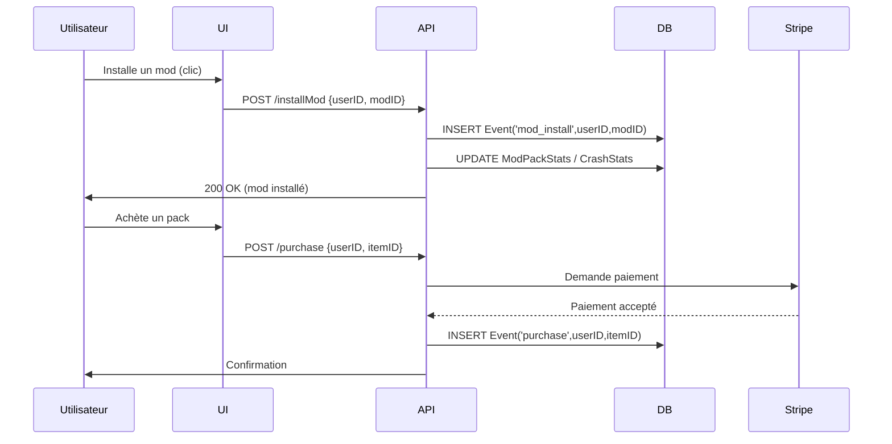
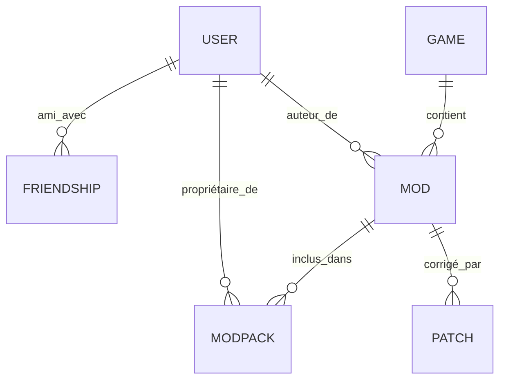

# Executive Summary

Ce rapport présente une étude approfondie de la phase « Profil / Communauté / Économie » pour **Modlab**, un gestionnaire de mods innovant centré sur l’utilisateur et la communauté modding. Nous explorons les objectifs produit (p.ex. interconnexion sociale, statistiques de profil), la philosophie (local‐first, transparence, fonctionnalités cœur gratuites, économie cosmétique), le périmètre fonctionnel (Profils, ModPacks, Mods, Patches, Knowledge Graph, MCP/IA, Marketplace, Extensions/WebView2, Event Ledger, vie privée) et les cas d’usage associés. Pour chaque domaine, nous décrivons les usages clés, les flux UX, le modèle de données, les événements à tracer, les API et permissions, les niveaux d’extensions, les scénarios d’intégration IA (Agents de jeu), ainsi que les contraintes de confidentialité. Nous proposons aussi **10 idées de gamification subtiles** et **10 mécaniques communautaires/économiques** (marketplace, commissions, packs, etc.) avec justification. Des tableaux comparatifs (benchmark concurrents sur 8 critères), d’infrastructure et coûts (prototype→10k MAU→100k MAU→scale) et une roadmap technique priorisée (MVP→v1→v2) sont fournis, ainsi que des diagrammes mermaid : architecture globale, flux d’événements, modèle ER du Knowledge Graph. Les recommandations opérationnelles comprennent étapes suivantes, risques et KPIs (rétention, engagement, CA). Les sources officielles (Microsoft WebView2, Supabase, Cloudflare, Stripe, DSA/UE) et la littérature sur gamification/local-first étayent les analyses. 

# Objectifs Produit

- **Profils sociaux et stats** : Permettre aux utilisateurs de se créer un profil pour se faire des amis, afficher des statistiques (nombre de mods utilisés, heures de jeu, crashs cumulés, modpacks publiés, etc.).  
- **Modding facilité** : Simplifier la création/modification de ModPacks pour tous types de jeux, avec détection de dépendances, gestion d’instances locales et conflits, sans passer par des outils tiers.  
- **Aspects communautaires** : Favoriser l’entraide des modders (p.ex. notification « cet utilisateur est l’auteur de ce mod » référencé dans la base), partage de packs et d’instances.  
- **Économie cosmétique et financement** : Introduire une économie de points ou monnaie virtuelle (gagnée par utilisation/engagement ou achetée), utilisée pour des objets cosmétiques de profil (avatars, thèmes) ou packs exclusifs. Organiser des cagnottes ou événements communautaires (modathons caritatifs, concours sponsorisés).  
- **Transparence et gratuité** : Le cœur de Modlab reste gratuit pour tous les utilisateurs. Toute monétisation (marketplace) sera transparente (via Stripe par exemple) et non bloquante, pour financer le logiciel et la scène modding (contribution de commissions sur ventes de packs/cosmétiques).  
- **Philosophie local-first et ouverte** : L’application doit fonctionner hors-ligne et se synchroniser avec le cloud (« stateless » côté serveur), réduisant la charge serveurs. L’accent est mis sur la maîtrise totale par l’utilisateur, avec données stockées localement et seulement partagées avec consentement (aligné DSA/UE sur protection et transparence). Les fonctionnalités payantes sont purement cosmétiques ou facilitation (p.ex. agents IA, autorisant un modèle freemium éthique).

# Philosophie

- **Local-first** : L’application privilégie le traitement local des données/utilisateurs, limitant le besoin de serveurs évolutifs. Par exemple, l’**IA locale (MCP, agents de jeu)** analyse et corrige les mods sur la machine de l’utilisateur, ne sollicitant le cloud qu’en option (synchronisation, backup). Cela réduit le coût d’infrastructure (« pas de scaling » large du back-end) et améliore la réactivité.  
- **Transparence** : Toute collecte ou partage de données est signalé clairement. Le code sera ouvert autant que possible (ex : base en open-source) et nous informerons l’utilisateur des finalités (via le registre d’événements et notifications). L’intégration de modèles IA (Claude, GPT, etc.) localement ou via API sera décrite.  
- **Fonctions cœur gratuites** : La gestion des mods (installation, désinstallation, sandbox, profils) et l’éditeur de code intégré seront gratuits pour tous. Les achats se limiteront aux contenus cosmétiques et services annexes (passe de combat optionnelle, monnaie virtuelle).  
- **Économie cosmétique et « gamification » subtile** : Nous proposerons des objets purement esthétiques (thèmes, avatars, titres de profil, emojis) échangeables avec des points gagnés par l’usage de Modlab ou achetés. Les mécanismes gamifiés doivent rester discrets, évitant les « patterns sombres » (ni progression forcée, ni récompense excessive) conformément aux principes UX (métaphore Apple : tout ce qu’il faut, où il faut, dosé comme il faut).  

# Périmètre fonctionnel

Nous couvrons : **Profils utilisateurs**, **ModPacks** (instances de jeu moddé), **Mods**, **Patches**, **Knowledge Graph modding**, **MCP/IA**, **Marketplace et monétisation**, **Extensions**, **Intégration WebView2/Mod Browser**, **Event Ledger** et **Vie privée**. Ces domaines forment un écosystème cohérent centré sur la communauté modding. Les sections suivantes détaillent chacun.

## 1. Profils Utilisateurs

**Description** : Chaque utilisateur possède un profil affichant son pseudonyme, avatar, « statistique card » (mods installés, heures de jeu, crashes cumulés, packs créés, trophees). On peut s’y ajouter en amis, suivre d’autres modders et commenter des mods/pack. Des titres de profil spéciaux (détachables) sont obtenus via des trophées ou actions (exemples : “Enthousiaste” pour utilisation intensive, “Archiviste” pour avoir ajouté +100 schémas Minecraft). Les titres rares peuvent être cachés (seul l’utilisateur sait quand il l’a obtenu).

- **Cas d’usage clés** :
  - Création/édition de profil (photo, description, thèmes cosmétiques)  
  - Affichage des stats agrégées (voir **plateau GitHub** des contributions modding, calendrier d’activité, etc.)  
  - Système d’**amis/abonnés** : se donner mutuellement des droits d’édition ou de modération sur ses packs, message privé.  
  - Flux d’actualités communautaire : notifications des amis (nouveau mod, crash report, événement).  
  - Attribution de **trophées et titres** (défis subtiles, ex : “Maître Patchwork” pour avoir corrigé 50 conflits de mod).

- **UX / Flows** :  
  - **Header de profil** : photo + nom + petits widgets de stats (heures totales, crashs, mods posés).  
  - **Showcase / Heatmap** : Grille visuelle des contributions (modpacks créés/dépendances) comme heatmap.  
  - **Statistiques détaillées** : Tableaux ou graphiques (p.ex. histogramme mensuel des crashes).  
  - **Lineage** : Affichage de filiation entre ModPacks (héritage des packs, forks).  
  - **Patch Workshop** : Espace où l’utilisateur peut soumettre des patches/fixes, gagner des points.

- **Données / Modèle** : Tables **User(id, pseudo, email, avatar, theme_id, stats…, creation_date)** ; **Friend(user_id, friend_id)** ; **Title(id, nom, description, secret, critere) ; UserTitle(user_id, title_id)**. Liaison n:n entre users (amis) via **Friend**, et n:n **UserTitle**. Les statistiques sont mises à jour via triggers ou via Event Ledger (voir plus bas).  

- **Événements (Event Ledger)** : `profile_view`, `friend_request`, `title_earned`, `achievement_unlocked`, `profile_edit` enregistrés avec timestamp. Utile pour analytics et rétention.  

- **API / Permissions** : Routes REST/GraphQL pour profil (GET/PUT /user/{id}), gestion amis (/friend/request, /friend/accept), liste trophées publics (/titles). Permissions : lecture publique du profil, modification limité à soi-même ou amis (pour commentaire partagé). RGPD: anonymiser si supprimé, consentement clair pour partage d’infos.  

- **Niveaux d’extension** : Extensions peuvent ajouter champs au profil (ex : “modeleur 3D”, “revitaisé”). Les APIs sont publiques pour plugins.  

- **Agents IA (Game Agents)** : Conseiller de progression : un agent qui suggère des objectifs (« Débloque le titre X en ajoutant 3 nouveaux mods ») ; modérateur de contenu pour détecter abus.  

- **Contraintes de confidentialité** : Données sensibles (email, identifiants) chiffrées. Les événements collectés sont pseudonymisés et stockés localement ou anonymement sur le cloud. Les amis et abonnements sont privés par défaut (contrôle d’accès). Conformité DSA pour marketplace (voir plus bas).  

## 2. ModPacks et Mods

**Description** : Un *ModPack* est une instance de jeu moddé (p.ex. “Skyrim magique v2”). Les *Mods* sont unitaires ou packages (plugins, textures). L’utilisateur peut créer, importer, exporter des modpacks, organiser l’ordre de chargement. Un Knowledge Graph stocke les dépendances et compatibilités entre mods et jeux.  

- **Cas d’usage clés** : 
  - Créer/modifier des ModPacks en glisser-déposer des Mods, avec aperçu de l’arborescence.  
  - Repérer conflits (overlay) et proposer des patches correctifs (« patch workshop »).  
  - Partager ses ModPacks et mods sur son profil (avec URL publique).  
  - Recherche avancée (par tags, jeu, author) grâce au Knowledge Graph.  

- **UX / Flows** : 
  - **Vue d’ensemble** : Tableau listant tous les ModPacks d’un utilisateur avec miniatures.  
  - **Editeur de pack** : interface similaire à MO2/Vortex (liste de mods, gestion des dépendances, cocher pour activer).  
  - **Patch Workshop** : zone collaborative pour soumettre/consommer des patchs, avec aperçu diff.  
  - **History** : visualisation du « lineage » (versions successives d’un pack).  
  - **Showcase** : page de profil ou dédiée montrant les packs publics et les mods créés.  

- **Données / Modèle** : Tables **Game(id, nom, genre)**, **Mod(id, name, game_id, author_id, version, description, archived)**, **ModPack(id, name, owner_id, game_id, settings)**, **ModPack_Mod(modpack_id, mod_id, order, enabled)**, **Patch(id, mod_id, description, diff_data)**. Relations : un mod appartient à un jeu et un auteur ; un modpack contient plusieurs mods. Knowledge Graph stocke en table **Compatibility(mod_id, mod_id, type)** ou via edges.  

- **Événements** : `mod_installed`, `mod_uninstalled`, `modpack_created`, `mod_conflict_detected`, `patch_applied`, `mod_updated`. Ils alimentent le Event Ledger pour analytics et peuvent déclencher notifications IA (ex : « un nouveau crash connu avec ce mod »).  

- **API / Permissions** : Endpoints pour mods (GET/POST/PUT /mods), modpacks (/modpacks), patchs (/patches). Permissions granulaire : création et suppression de mods/modpacks par leur auteur, consultation publique possible pour certains packs (opt-in). Les mods peuvent déclarer leur auteur via OAuth/Nexus.  

- **Extensions** : Plugins peuvent ajouter de nouvelles étapes à l’éditeur (p.ex. générateur de load order automatique avec IA), ou interfaces de modding (éditeur de code intégré, examen de scripts). Chaque extension s’exécute en sandbox client ou en worker cloud.  

- **Agents IA** : Agents spécifiques au jeu (« Game Agents ») peuvent analyser des logs/crashs et proposer un patch. Un agent “Automerge” pourrait rebaser des mods incompatibles. Documentation de modding (fichiers .esp, API de jeu) sert de contexte pour l’IA locale.  

- **Confidentialité** : Les packs et mods publics sont partagés sous licence ouverte ou CC choisie par l’auteur. Le propriétaire peut supprimer un mod et demander anonymisation des données liées. Les patches privés restent confidentiels. Pas de collecte forcée de données de pack.  

## 3. Patches

**Description** : Espace collaboratif pour créer et partager des *patchs* ou correctifs entre mods (ex : traduction, compatibilité). Chaque patch est associé à un ou plusieurs mods (Git-like). Les utilisateurs peuvent appliquer ces patchs à leurs modpacks.

- **Cas d’usage** : 
  - Soumettre un patch (source et cible, diff minimal) pour corriger un mod ou intégrer deux mods.  
  - Appliquer un patch d’un click sur un mod ou instance.  
  - Récompenses (points, badge) pour patchs utiles (rapportés comme ayant résolu un crash).  

- **UX / Flows** : 
  - **Patch Workshop Interface** : Zone dédiée où l’on voit la liste de patchs proposés, filtres par jeu/mod.  
  - **Éditeur de patch** : éditeur de diff visuel, test sur pack avant validation.  
  - **Lineage** : historique des patchs appliqués.  

- **Modèle de données** : Inclus ci-dessus (**Patch**). On peut ajouter **PatchApplication(id, user_id, patch_id, date)** pour suivre usage.  

- **Événements** : `patch_created`, `patch_applied`, `patch_reverted`. Utiles au Event Ledger.  

- **API/Permissions** : POST /patches (auteur ou équipe), GET /patches. Tout utilisateur peut appliquer un patch sur son pack (sécurité locale). Les patchs publics sont open-source.  

- **Extension** : Permettre aux extensions de générer automatiquement des patchs (ex : « resolve move file »).  

- **IA** : Auto-génération de patchs par l’IA en analysant deux mods incompatibles.  

- **Confidentialité** : Les patchs peuvent être marqués privés (fonctionne en pair-à-pair local) ou publics. Rien de sensible à collecter, sauf logs de test si nécessaire (consentement).

## 4. Knowledge Graph Modding

**Description** : Base de connaissances graphique reliant jeux, mods, dépendances, conflits, fichiers de configuration, bugs connus, tutoriels. Permet recherche sémantique et inférence (p.ex. suggérer quel mod pourrait causer un bug). Objectif : centraliser la connaissance modding (inspiré par Modlab Knowledge Graph).

- **Cas d’usage** : 
  - Suggérer automatiquement des mods compatibles ou nécessaires lors de l’import d’un modpack.  
  - Alerter l’utilisateur d’un potentiel conflit (en se basant sur des données collectées).  
  - Offrir une section wiki/FAQ intelligente (FAQ auto-complétion avec GPT sur docs de modding).  

- **UX / Flows** : 
  - **Graph View** : Visualisation interactive de la relation entre un mod et ses dépendances/conflits.  
  - **Recherche sémantique** : Champ de recherche où l’utilisateur demande (en langage naturel) comment installer un mod, et l’IA renvoie étapes à partir du Knowledge Graph.  
  - **Recommandations** : Section « mods recommandés pour ce pack » selon graph.  

- **Modèle de données** : Tables **Entity(id, type, name)** et **Edge(src_id, dst_id, relation_type)**. Types : {Game, Mod, Category, Resource}. Relations : {depends_on, conflict_with, similar_to, tutorial_for}. Entités sont importées par crowdsource (mod authors déclarent leurs dépendances) et via scraping (Nexus API, forum).  

- **Événements** : `graph_update` lors d’ajout de mod, `dependency_discovered`, `conflict_resolved`. Permet log.  

- **API/Permissions** : Endpoints graphQL pour interroger le Knowledge Graph (p.ex. `/graphql?query={mod(id:123){dependencies{name}}}`). Permissions en lecture larges, écriture seulement pour modders vérifiés.  

- **Extensions** : Plugin IA qui branche des agents sur le graph (ex : « ajoute automatiquement cette dépendance au modpack »).  

- **IA** : Agents « explorateurs de graph » qui apprennent de nouveaux liens à partir de la communauté ou du web, et agents de débug qui utilisent le graph + logs pour diagnostiquer.  

- **Confidentialité** : Les données sont non sensibles (open modding). Seules les données issues de l’utilisateur (p.ex. crash logs anonymisés) alimentent le graph avec consentement.

## 5. MCP / IA Locale

**Description** : **Modlab Composition Provider (MCP)** est l’interface IA locale intégrée, épaulée par des agents contextuels. Il utilise Claude, GPT ou autres modèles (locaux ou API) pour assister le modding (vérification, génération de patchs, aide au debugging). Tout se passe localement ou de façon privée (privacy by design).

- **Cas d’usage** : 
  - Détecter automatiquement les conflits de mods et proposer la résolution via patch.  
  - Compléter du code de mod ou de script (éditeur de code intégré).  
  - Générer des descriptions de mods ou tutoriels à partir des données (NLP).  

- **UX / Flows** : 
  - **Assistant Modding** : Fenêtre latérale chat-like où l’utilisateur discute de son problème de modding et l’agent suggère des actions.  
  - **Analyse automatique** : Après installation d’un mod, l’agent vérifie la compatibilité (bouton « Analyser mod »).  
  - **Éditeur de code** : Ouverture du code source d’un mod avec auto-complétion IA (plugins VSCode-like intégrés).  

- **Modèle de données** : Principalement les ressources existantes (mods, graph, stockage local). L’IA peut créer des logs/annotations (stockés localement).  

- **Événements** : `ia_question`, `ia_answer`, `code_generated`. Pour suivi interne (non public).  

- **API/Permissions** : L’IA locale n’a pas d’API externe par défaut. Si API cloud (Claude/OpenAI) utilisées, transparence sur données envoyées. Permissions spécifiques pour appeler l’API.  

- **Extensions** : On peut ajouter des agents pour chaque jeu (ex : « Skyrim Agent », « Minecraft Agent ») avec datasets de modding.  

- **Confidentialité** : Par défaut tout se fait localement. Si des requêtes externes sont nécessaires (par ex. abonnement à un LLM), l’utilisateur en est informé. Aucune donnée personnelle n’est partagée sans consentement.

## 6. Marketplace & Économie

**Description** : Un système de marketplace intégré où les créateurs peuvent vendre leurs ModPacks ou contenus cosmétiques (avatar, thème). Les utilisateurs achètent avec des points (« ModPoints ») gagnés par usage ou en achetant des packs de points via Stripe. Modlab prend une commission transparente (p.ex. 10%) sur les ventes.

- **Cas d’usage** : 
  - Création d’un **ModPack à vendre** : Un moddeur fixe son prix (ou le laisse gratuit).  
  - **Achats** : Utilisateur dépense des ModPoints pour des items cosmétiques (thème UI spécial, badge), ou achète un pack de création (ex: DLC de mods).  
  - **Cagnottes et événements** : Organisation de campagnes, où un pourcentage des ventes alimente un fonds (pour modathons, charité).  
  - **Éditions limitées** : Objets cosmétiques rares pour une durée limitée (par ex. « thème halloween 2026 ») financent la communauté.  
  - **Commission** : Modlab prélève une commission sur chaque transaction, permettant de financer le développement.

- **UX / Flows** : 
  - **Boutique intégrée** : Onglet Marketplace avec catégories (ModPacks, Cosmétiques, Événements).  
  - **Transaction** : Panier d’achat, paiement Stripe intégré (paiement carte ou vente de points).  
  - **Inventaire** : Utilisateur a un portefeuille de points et un inventaire d’objets cosmétiques achetés.  
  - **Cagnottes** : Indicateur de collecte (p.ex. barre de progression sur page accueil pendant un mois “X% reversé à Y”).  

- **Données / Modèle** : Tables **Item(id, type, name, price_points, price_money, creator_id, stock_limit, ephemeral)**, **Purchase(id, buyer_id, item_id, date, points_used)**, **Fundraiser(id, name, target_amount, collected, start,end)**, **FundraiserContribution(user_id, fundraiser_id, amount)**. Liaison avec **ModPack** si l’item est un pack à vendre. Comptes utilisateurs ont **points_balance**. Les créations financières suivent table **Seller (User + KYC info)**.  

- **Événements** : `purchase_item`, `earn_points`, `redeem_code`, `fundraiser_started`, `fundraiser_contributed`. Ces logs aident aux métriques CA et engagement.  

- **API/Permissions** : Routes **/items**, **/purchase**, **/wallet**, **/fundraisers**. Vérification KYC (DSA exige vendeurs identifiés) pour publicités. Les créateurs de contenu s’enregistrent en tant que « vendeurs », fournissent coordonnées (DSA) et bénéficient de l’interface Stripe Connect pour recevoir paiements nets.  

- **Extensions** : Possibilité de rajouter des moyens de paiement (crypto, micropaiements) via extensions.  

- **IA** : Agent suggestions de pack à vendre, tarification dynamique (IA fixe recommandation de prix selon le jeu).  

- **Confidentialité** : Respect des régulations (DSA) : vérification des vendeurs (nom, entreprise, pays) est requise pour la section marketplace, et leurs informations sont accessibles aux acheteurs. Transactions chiffrées, données financières stockées sous PCI DSS (via Stripe).  

## 7. Extensions et WebView2

**Description** : Modlab est extensible : plugins installables ajoutent des fonctionnalités spécifiques (nouveaux jeux, intégrations, UI). L’interface Mod Browser exploite **WebView2** (navigateur intégré) pour afficher des contenus en ligne (Nexus, Wiki). On peut ajouter des options au navigateur intégré (voir personnalisation WebView2).

- **Cas d’usage** : 
  - **Extensions tierces** : Ex: un plugin « Overwolf » pour synchroniser mods de Valheim, ou un plugin d’analyse de dumps de jeux spécifiques.  
  - **WebView2 modifié** : Permettre à l’utilisateur d’installer des boutons personnalisés dans la vue web (ajout d’une option “Ajouter au ModPack” sur une page Nexus).  
  - **Aide in-app** : Intégrer des docs (Markdown/HTML) via WebView2 dans l’application sans sortir.

- **UX / Flows** : 
  - **Boutique d’extensions** : Liste d’extensions officielles et communautaires (classées par popularité).  
  - **Installer/mettre à jour** : Gestion des extensions côté client (similar to VSCode ou GMod).  
  - **Custom Context Menu** : Grâce à WebView2, le menu contextuel peut être personnalisé ou désactivé (ex : bouton “Signaler sur Discord” ou “Copier ModID”).  
  - **Options de WebView2** : Contrôle des permissions (média, accès fichier), activer/désactiver JavaScript, caches.  

- **Données / Modèle** : Table **Extension(id, name, author_id, version, entrypoint, permissions_required)** et **UserExtension(user_id, extension_id, enabled)**. Les extensions déclarent leurs permissions (accès fichier local, internet) dans l’app.  

- **Événements** : `extension_installed`, `extension_enabled`, `context_menu_item_used`.  

- **API/Permissions** : Un mécanisme de sandbox empêche les extensions de corrompre l’installation. Les API publiques permettent aux extensions de manipuler les ModPacks via interfaces (exposition de hooks JS sur le front-end). Les permissions WebView2 (géoloc, médias) sont demandées explicitement à l’utilisateur.  

- **Niveaux d’extension** : Plugins *officiels* validés par Modlab (vouchés) peuvent faire plus (ex: signer leurs requêtes). Extensions « non fiables » s’exécutent en mode restreint (ex : pas d’écriture système sensible).  

- **IA / Agents** : Marketplace d’agents additionnels (ex : agent « traduire ce mod »).  

- **Confidentialité** : Extensions tierces doivent respecter des politiques ouvertes (pas de collecte de données cachée). WebView2 respecte la politique de confidentialité du contenu chargé, mais on peut injecter des règles CORS ou blocage. On utilise `CoreWebView2Settings.AreDefaultContextMenusEnabled` etc. comme indiqué dans la documentation Microsoft pour désactiver le menu par défaut si besoin.  

## 8. Journal d’Événements (Event Ledger)

**Description** : Infrastructure de log orientée événements, consignant toutes les actions clés (comme un Event Sourcing). Sert d’audit, analytics (KPIs) et base pour les tableaux de bord. Exemples d’événements : installation de mod, achat en marketplace, crash de mod, connexion utilisateur.

- **Cas d’usage** : 
  - Suivi de l’engagement (ex : nombre de sessions/jour, mises à jour du pack).  
  - Sécurité (historique des modifications importantes).  
  - Récompenses basées sur l’activité (IA lit l’Event Ledger pour proposer des trophées).  
  - Synchronisation possible (backup sur serveur / ticket anonymisé).

- **Flows** :  
  - Chaque action déclenche un log JSON (user_id, action, timestamp, metadata). Par ex. `{"event":"mod_install","user":123,"mod":456,"time":...}`.  
  - Un pipeline (via Cloudflare Workers) agrège/analyse ces logs (streaming ou batch).  
  - Tableau de bord Analytics en back-office (nombre crashs journaliers, actions marketplace).  

- **Données / Modèle** : Event Ledger est un service append-only. On peut le stocker dans une table de la DB (**Events(id, user_id, type, payload JSON, created_at)**) ou sur R2/S3 au format journal.  

- **API/Permissions** : Event ingestion via API interne. Les accès en lecture autorisés seulement pour admins (sous accords RGPD).  

- **Intégration IA** : Agents analytiques (dashboard IA) synthétisent les données pour rapports intelligents.  

- **Vie privée** : Les logs ne stockent que les IDs (pas de PII en clair) et sont soumis aux choix de l’utilisateur (opt-in à l’anonymisation). Compliance avec DSA sur données (p.ex. droit d’accès ou suppression d’événements la concernant).

## 9. Vie Privée & Conformité

**Description** : Cadre global de confidentialité conforme au RGPD et à la DSA/UE. Modlab est « local-first », réduisant automatiquement les données envoyées. Toutes les fonctionnalités payantes respectent les obligations légales (traçabilité du vendeur, paiement sécurisé, vérification des contenus interdits).

- **Consentement et données** : À l’inscription on demande accord clair pour la collecte d’événements. Les données personnelles (email, identifiants tiers) sont chiffrées. Les utilisateurs peuvent exporter/effacer leurs données.  
- **DSA/Marketplace** : Les vendeurs sur le marketplace doivent se déclarer (nom réel ou nom d’entreprise) et leurs coordonnées sont publiées en accord avec la directive DSA (vendeurs vérifiés). Les contenus illégaux/violant droits (mods piratés) sont signalés et retirés avec procédure de recours (DSA exige transparence).  
- **Cryptage & Accès** : Toutes les communications sensibles passent en HTTPS (TLS). Les API internes vérifient les tokens Supabase (JWT). Les comptes Stripe Connect sont liés en OAuth via un service serveur pour sécuriser le secret.  

# Idées de Gamification subtiles

1. **Titres de profil semi-cachés** : Attribuer des titres de profil rares découverts après certaines actions, sans révéler les conditions. Par ex. « Maître Schematics » (donné à l’utilisateur qui importe 100 schémas Minecraft). L’obtention reste discrète (les joueurs voient seulement qu’un autre a ce titre) pour susciter la curiosité.  
2. **Cosmétique évolutif discret** : Des thèmes de profil qui « évoluent » en fonction de l’activité. Ex : un thème de base (bleu) qui prend des ornements or après 1 an d’activité, ou lorsqu’on atteint 100 mods installés. Pas de barre de progression explicite, juste un effet visuel.  
3. **Mini-événements surprises (Easter eggs)** : Intégrer de petits jeux cachés (p.ex. le jeu du dinosaure de Chrome en cas d’erreur réseau, ou un autoclicker rigolo sur logo). Déclicant certaines touches permet de débloquer un badge secret. Cela surprend positivement et renforce la curiosité sans forcer l’utilisateur à jouer.  
4. **Défis communautaires temporaires** : Sans contrainte, proposer de temps en temps un défi optionnel (« Commenter 10 mods cette semaine ») débloquant un petit badge collaboratif. Pas de récompense matérielle, juste un élément graphique et une mention sur le profil. Ce type de défi encourage l’engagement social progressivement.  
5. **Statistiques visualisées** : Afficher subtilement des graphiques agréables (par ex. heatmap d’activité style GitHub) pour valoriser le profil. Voir ses propres stats visuellement est gratifiant. Exemple : « tu as installé 15 mods ce mois » avec un petit feu d’artifice graphique.  
6. **Collections personnalisées** : Permettre aux utilisateurs de collectionner des icônes de mods ou de jeux (comme des pins). Chaque modpack ou mod exceptionnel débloque une icône spéciale à exposer sur son profil. Discret car ce n’est qu’une petite image, mais cela crée une fierté.  
7. **Machine de succès discrète** : Implémenter un système implicite de progression (p.ex. montée de rang invisible) utilisée en interne par l’IA pour offrir de nouveaux conseils. L’utilisateur n’en voit que le résultat (par exemple, l’IA suggère des trucs différents selon son « niveau »), sans pointeur visible.  
8. **Récompenses basées sur la communauté** : Par exemple, chaque mois la communauté vote pour le « ModPack de l’année » et son créateur reçoit un titre spécial. Renforce l’engagement communautaire sans pression, car c’est aléatoire et basé sur appréciation.  
9. **Feedback tactile/visuel** : Ajouter des micro-animations sur réussite d’action courante (comme une petite étoile scintillante quand on installe un mod). C’est intuitif et renforce l’effet de satisfaction sans lourdeur.  
10. **Parcours d’accueil ludique** : Lors de l’onboarding, guider l’utilisateur à travers quelques étapes (« crée ton premier modpack ») avec un mini-checklist qui montre la progression du setup de manière ludique (sans blocage, mais récompensant par un badge « Nouveau Aventurier » quand terminé).  

Ces idées s’inspirent de principes de gamification légère (gameful design) : récompenses non oppressives, mystère, éléments de collection, tout en évitant des mécaniques trop « accroche ». Elles accompagnent l’utilisateur plutôt qu’elles ne le bloquent.

# Mécaniques Communautaires et Économiques

1. **Marketplace de Mods et Cosmétiques** : Comme décrit, un magasin intégré où créateurs vendent ModPacks ou avatars. Cela donne un revenu aux créateurs (au moins 90% des ventes, resté pour la communauté). Cela incite les talents à contribuer car ils peuvent monétiser leur travail, favorisant l’écosystème. (Commission modérée, ex. 10%).  
2. **Collections et Sets** : Les utilisateurs peuvent créer des **collections** (sets) de mods ou de cosmétiques et les partager/monétiser. Par exemple, un utilisateur célèbre vendra son « pack starter » de mods pour jeu X à prix fixe. Cela stimule la reconnaissance des créateurs et la découverte par la communauté.  
3. **Éditions limitées et exclusives** : Sortir périodiquement des objets en série limitée (p.ex. un thème de profil spécial pour un événement). Leur rareté et caractère temporaire génèrent de l’engagement (« Il faut être présent ce mois-ci ») sans bloquer l’accès aux fonctions courantes.  
4. **Cagnottes communautaires** : Chaque mois, X% des ventes (ou une partie des points de récompense) alimente une cagnotte destinée à financer un événement modding (hackathon, charité). Les membres de la communauté peuvent proposer ou voter le projet financé. Cela crée un sentiment d’appartenance et montre que les contributions servent à la cause modding, pas qu’aux profits privés.  
5. **Système de commission pour créateurs** : Inciter les joueurs à « parrainer » un créateur de mod en lui allouant un pourcentage de leurs achats (mécanisme de commission). Par exemple, en suivant un auteur, une part de leurs achats sur le marketplace lui revient comme bonus. Cela motive les moddeurs à rejoindre la plateforme pour gagner des commissions.  
6. **Objets NFT (optionnel)** : Permettre éventuellement de vendre des cosmétiques sous forme de NFT, si une utilité est définie (certificats de rarité ou propriété). Ceci reste très exploratoire car sans utilité claire, le simple fait d’être NFT n’apporte pas de valeur dans notre contexte sans marché secondaire actif. On peut plus simplement générer un certificat numérique d’authenticité pour les créateurs (metadonnées intégrées dans l’objet).  
7. **Enchères et Dynamique de Prix** : Autoriser les créateurs à mettre des packs en enchères. Les utilisateurs peuvent enchérir en points sur un pack unique (ex. modpack collector). Cela crée du dynamisme et de l’interaction sociale lors d’événements spéciaux.  
8. **Titres procéduraux/événements** : Comme déjà évoqué, des titres de profil générés de façon semi-procédurale par la communauté (ex. “Dragon Slayer” pour avoir téléchargé le mod le plus téléchargé du mois, titre visible par tous). Ces titres récompensent des actions collectives et ne coûtent rien en tech, mais renforcent la compétition saine.  
9. **Packs créateur (“Creator Packs”)** : Offrir aux créateurs la possibilité de vendre un « Creator Pack » : ensemble de 3 à 5 mods cosmétiques ou utilitaires, à prix fixe réduit. Cela aide à promouvoir les créateurs (visibilité dans la boutique) et à offrir des combos attractifs aux acheteurs.  
10. **Marché de services/commissions** : Au-delà des contenus, permettre aux développeurs avancés de proposer des services (p.ex. création sur commande, customisation de mods) rémunérés via la plateforme. Un système de feedback et notation assurera la qualité. Bien que plus rare, cela peut professionaliser la scène modding (FAQ: bien que proche du freelancing, c’est une option pour certains moddeurs).

Ces mécanismes s’articulent autour de l’économie « cosmétique » et de l’implication communautaire, sans imposer de paywall sur les fonctionnalités de base. Ils permettent à la plateforme de générer des revenus (pour se financer et financer la communauté) tout en offrant de nouvelles expériences sociales et de satisfaction (sense of mastery, appartenance).

# Benchmarks Concurrents (MO2, Vortex, Nexus, Steam Workshop, Thunderstore)

| **Critères**                | **Mod Organizer 2**                   | **Vortex** (Nexus)                | **Nexus Mods (site)**            | **Steam Workshop**                     | **Thunderstore** (Overwolf)                          |
|-----------------------------|---------------------------------------|-----------------------------------|----------------------------------|-----------------------------------------|------------------------------------------------------|
| **Plateformes**             | Windows uniquement (open-source)      | Windows (intégration Nexus)       | Web (multiplateforme via navigateur) | Windows/macOS/Linux via Steam client     | Windows, Overwolf (PC)                               |
| **Jeux supportés**          | Majoritairement Bethesda (Skyrim, Fallout…) | >500 jeux (divers)      | 1000+ jeux (tous genres)        | Centaines de jeux Steam (avec API WS)     | ~300 jeux indie spécifiques (Valheim, Risk 2…) |
| **Gestion des mods**        | Profiles, USVFS, grand contrôle manuel  | Automatisation (autotri, auto-overwrite) | Aucun (site de distribution seulement) | Intégré au client (auto-installe)         | Gestion basique (enable/disable via manager)   |
| **Fonctionnalités communautaires** | Aucune (outil local)               | Limitée (profil Nexus requis)      | Profils utilisateurs, commentaires, collections, favoris | Profils Steam, Achievements, stat de jeu  | Communauté Discord/Wiki (peu d’interactivité in-app) |
| **Marketplace/monétisation** | Aucune (opensource)                   | Aucune (gratuit, pas de store)     | Aucune vente (dons possibles)    | Workshop peut proposer du contenu payant (ex : Creation Club) | Contenus gratuits; la boutique Overwolf vend Premium (templates) |
| **Extensions/API**         | Plugins par la communauté (modders)    | UI extensible, API Nexus partagé  | API publique (mods, mods count)  | API Steamworks (pour devs)             | API publique, open-source (client/serveur)     |
| **Vie privée / Local-First** | Fortement local (aucune collecte)      | Nécessite compte Nexus (en ligne)  | Centralisé (Nexus Mods)          | Connecté à Steam (Valve), données utilisateurs | Front-end local, mais Overwolf collecte télémétrie (config) |
| **Tarification générale**   | Gratuit (open-source)                | Gratuit (fermé, sans pub)          | Gratuit (ad-support, membres Premium) | Par jeu (Workshop inclus), pas de coût direct pour utilisateurs | Application gratuite, avec pub/in-app purchases (Thunderstore Premium) |

**Sources** : Sites officiels et documentations : Vortex (Nexus Mods), Thunderstore (Overwolf), ainsi que documentation publique sur les autres plateformes.  

# Options d’Infrastructure et Coûts

Nous partons d’une stack cible (frontend Tauri + WebView2, backend Supabase/Postgres, Cloudflare Workers, R2, Stripe). Voici des estimations de coûts **croissants** en fonction du trafic utilisateur (MAU = utilisateurs actifs mensuels) :

| **Palier**              | **Infrastructure**                                                                              | **Approx. Coût (€/mois)** |
|-------------------------|------------------------------------------------------------------------------------------------|----------------------------|
| **Prototype (<100 MAU)**    | Supabase Free (base 500 MB, 50 k MAU) ; Cloudflare Workers Free (100k req/jour) ; Pages gratuit ; R2 (10 GB gratuit). Stripe sans frais fixes.   | ≈ **0** (tout gratuit)      |
| **10k MAU**                | Supabase Free ou Pro : Free couvre 50k MAU, peut rester gratuit ; Cloudflare toujours gratuit. Croissance modérée, offload analytic/pub. | ≈ **0–5 €**                |
| **100k MAU**               | Passer à Supabase Pro ($25 = ~23 €) couvre 100k MAU ; Cloudflare Workers Unlimited ($5 = ~4.6 €) ; R2 gratuit (10 GB) et Pages gratuit suffisent. Stripe prélève ~1.5–3% par transaction, négligeable à faible volume.  | ~**30 €** total (host)    |
| **Scale (+100k MAU)**       | Supabase Pro upgradé (ajout de compute si besoin), ou Enterprise (≥$599) ; Cloudflare Enterprise features (DDoS, KV, Durable Objects). Ajout éventuel de Redis/Redis Edge (ex. Upstash) ; montée en gamme du stockage.  | **100–1000+ €** selon dimension |

Ces estimations sont basées sur [Supabase Pricing] et sur la structure de **Cloudflare** (Workers 100k req/jour free, plan Unlimited $5/mo). Stripe n’a pas de frais mensuels (appliqué uniquement par transaction : p.ex. 1,5%+0,25€ pour carte EEE). L’infra serverless (Workers+R2) permet d’avoir un coût presque nul jusqu’à des usages très importants. L’hébergement du frontend Tauri est local client.

**Recommandations Infra** : débuter avec Supabase Free + Cloudflare Free pour un MVP « tout compris » à coût 0 (parfait pour presales). Ensuite, Supabase Pro à 100k MAU pour le lancement public, et surveiller usage via logs. Prévoir de basculer sur plan supérieur ou ajouter des Workers KV/D1 si besoin de persistance global sans DB.

# Roadmap Technique

| **Version** | **Fonctionnalités clés à livrer**                                                                                  | **Priorité** |
|-------------|--------------------------------------------------------------------------------------------------------------------|--------------|
| **MVP**     | - Fonctionnalités de base : gestion de mods et instances local (profils restreints), installation WebView2, création de ModPacks, Event Logging simplifié.<br>- Profil minimal (pseudo, avatar, statiques de base). Pas de marketplace.<br>- Knowledge Graph léger (ex. gestion des dépendances basique).<br>- Suppression de flame, juste un petit système de “suivre” sans monétisation. | 🔴 (haute)   |
| **v1**      | - Profils étendus (amis, socle de stat, titres basiques).<br>- Marketplace basique : gestion de monnaie virtuelle (points) et quelques objets cosmétiques.<br>- Titres de profil et achievements (p.ex. « nombre de mods installés »).<br>- Analyse crash par MCP local et correctifs simples.<br>- Event Ledger complet, tableau de bord analytics minimal.<br>- WebView2 custom context (boutons Nexus), extensions simples (import de mod du Web). | 🟠 (moyenne) |
| **v2**      | - IA avancée : agents par jeu (patch automatique, complétion de code).<br>- Gamification (mini-jeux cachés, quêtes communautaires).<br>- Événements réguliers, cagnottes caritatives.<br>- Extensions avancées (SDK complet, UI plugin).<br>- Optimisation scale-infra (cache, durable objects).<br>- Intégrations sociales supplémentaires (Discours ou forums modding intégrés, notifications push). | 🟢 (basse)   |

Ce roadmap est flexible et priorise un lancement rapide avec une version stable (MVP) pour valider les concepts de communauté/profil. Les fonctionnalités plus « prospectives » (IA, gamification poussée) sont planifiées pour des versions ultérieures, une fois la base utilisateur et l’infra en place. 

# Diagrammes

**Architecture globale** :  
```mermaid
graph LR
  subgraph Client
    UI[Tauri + WebView2 UI]
    LocalAI[IA & MCP (local)]
  end
  subgraph Serveur
    API[API (Supabase / Cloudflare Workers)]
    DB[(PostgreSQL DB)]
    R2[R2 Storage (Objets)]
    Events[Event Ledger]
    Stripe[Stripe Connect]
  end
  UI -->|REST/WS| API
  UI --> LocalAI
  API --> DB
  API --> R2
  API --> Events
  API --> Stripe
```

**Flux d’événements (Event Flow)** :  


**Modèle ER du Knowledge Graph (simplifié)** :  


# Recommandations et KPIs

- **Suivi des KPIs** : nombre d’utilisateurs actifs (MAU/DAU), taux de rétention mensuel (cohort analysis), nombre de packs/mods créés, temps moyen passé sur l’app, nombre de transactions marketplace et CA généré, nombre de tickets/support.  
- **Étapes suivantes** : Développer le MVP en validant le modèle local-first (tests sans serveurs intensifs). Organiser des focus groups de moddeurs pour affiner la gamification. Lancer un pilote fermé pour itérer (installer divers jeux et situer la complétude des features).  
- **Risques** : Complexité technique d’intégrer l’IA locale (tests de performance GPU/CPU). Dépendance aux APIs externes (ex. changement de politique sur Nexus ou Discord). Adoption faible sans effet réseau (besoin d’un critical mass initial).  
- **Opérations** : Prévoir un canal Discord/forum officiel pour la communauté, modération et support. Documenter la plateforme (wiki) et guidelines de contributions (DD). Anticiper la mise en conformité DSA (registre des vendeurs, incidents de contenu).  

En mettant l’utilisateur au centre (« **local-first, transparence, qualité Apple** ») tout en cultivant des éléments ludiques et communautaires subtils, Modlab se différenciera comme un « écosystème modding » complet. Les fonctionnalités de profil communautaire, complétées d’une économie cosmétique éthique, renforceront la rétention et la valeur à long terme de la plateforme.

